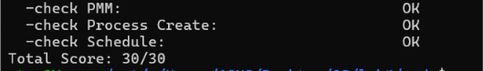
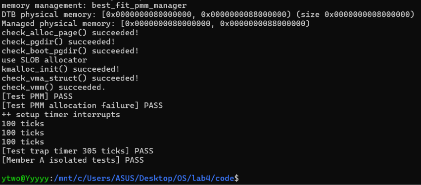

# OS\-lab4

# **实验基本信息**

|项目|内容|
|---|---|
|**实验名称**|Lab 4: 进程管理|
|**小组成员** |2412266\-杨滢、2412103\-唐健、2412566\-曹子衿|
|**完成日期**|2026\-11\-18|

## **小组分工**

### （1）练习分工

|成员|负责的练习/模块|
|---|---|
|2412266\-杨滢|前置代码迁移；功能模块一：虚拟内存页操作功能；Challenge：Sv32／Sv39／Sv48 与 get\_pte\(\) 的相似代码 ；虚拟内存页操作测试|
|2412103\-唐健|功能模块一：进程创建与初始化功能；Challenge：get\_pte\(\) 接口设计分析；进程创建与调度测试|
|2412566\-曹子衿|功能模块三（进程调度与上下文切换）、中断开关 Challenge、集成验收 |

### （2）实验报告撰写分工

|成员|负责的练习/模块|
|---|---|
|2412266\-杨滢|第2、3章；4\.1、4\.2、4\.5\.1节；5\.1节；第6章|
|2412103\-唐健|4\.3，4\.5\.2节；5\.2节|
|2412566\-曹子衿|4\.4、4\.5\.3、5\.3、5\.4节；补充实验环境|

---

# **一、实验目的**

1. 了解虚拟内存管理的基本结构，掌握虚拟内存的组织与管理方式

2. 了解内核线程创建/执行的管理过程

3. 了解内核线程的切换和基本调度过程

---

# **二、实验环境**

## 2\.1 你们使用的 AI 工具

|成员|AI 编程工具|底层模型|备注|
|---|---|---|---|
|2412266\-杨滢|OpenAI Codex|GPT\-6 Astra|无|
|2412103\-唐健|OpenAI Codex|GPT\-6 Astra|无|
|2412566\-曹子衿|OpenAI Codex|GPT\-6\.1 Sol |无|

## 2\.2 实验环境

成员1、2的实验在 Windows 宿主机上，通过 WSL 的 Ubuntu 环境进行编译和运行。内核面向 RISC\-V 64 位架构，由 QEMU 模拟 `virt` 平台，通过默认固件启动。页表采用 Sv39 模式，基础页大小为 4 KiB。

|**项目**|**配置**|
|---|---|
|**宿主系统**|Windows 11|
|**编译与运行系统**|WSL Ubuntu|
|**目标架构与模拟平台**|RISC\-V 64 位；QEMU `virt`|
|**内存管理模式**|Sv39 三级页表；4 KiB 基础页|
|**构建工具**|GNU Make、GCC 交叉工具链及 Binutils|
|**交叉工具链配置**|Makefile 默认前缀为 `riscv64-unknown-elf-`|

成员 C 在 macOS 宿主机使用项目已有的 Docker 隔离环境进行编译、调试和完整集成验收。容器为 Ubuntu 22\.04\.5 LTS、`linux/amd64`，目标为 RV64，交叉 GCC 10\.2\.0、交叉 GDB 10\.1、GNU Make 4\.3、Python 3\.10\.12，QEMU 为 4\.1\.1（`os-project-signalfd4-1`），默认固件报告 OpenSBI v0\.4。镜像为 `os-project-lab:ubuntu22.04-amd64`。编译产物与测试日志保存在项目专用目录，源码以只读方式挂载后复制到容器内构建。

---

# 三、实验整体逻辑分析

### 3\.1 本章节的逻辑主线

本实验围绕“**如何将一个内核执行流组织为可管理、可创建、可切换的线程**”展开。前序实验已经建立了物理页管理和中断处理基础，Lab4 在此之上引入**进程控制块、内核线程创建和调度机制**，将内存资源与 CPU 执行现场联系起来。

一个线程能够运行，需要同时具备资源和执行状态。物理页管理为内核栈及页表等对象提供存储空间，页表维护虚拟地址到物理地址的映射；进程控制块记录线程身份、状态、内核栈、页表基址和上下文；创建逻辑准备首次运行现场；调度器选择可运行线程，切换机制使 CPU 转入对应的执行流程。因此，分配 PCB、建立线程和真正执行线程分别属于不同阶段，不能仅凭某个对象已经创建就认定线程已经运行。

当前实验只创建内核线程。线程拥有独立的内核栈与执行现场，但共享内核地址空间，`mm` 为 `NULL`，PCB 中的 `pgdir` 指向内核页表的物理基址。

### 3\.2 功能的逐步实现

1. **首先完成 Lab2、Lab3 前置代码的迁移与适配**

迁移物理内存初始化、物理页分配与回收、异常处理、时钟中断以及陷阱现场保存和恢复代码。之所以首先完成这部分，是因为后续页表和线程内核栈都需要通过物理内存管理器分配空间，新线程首次运行也需要使用已有的陷阱返回机制恢复寄存器现场。只有先保证内存管理和中断处理能够正常工作，后续 Lab4 功能才具备可靠的运行基础。

2. **接着实现虚拟内存页操作功能**

实现 `page_insert()`、`page_remove()` 和 `page_remove_pte()`，完成虚拟地址映射的建立、替换、权限更新和删除，同时维护物理页面引用计数并在页表发生变化后刷新 TLB。之所以在进程创建前完成该功能，是因为地址映射和物理页面管理是进程内存资源管理的基础。只有保证页面能够被正确映射和回收，后续分配线程内核栈及使用内核页表时才不会出现错误引用或资源泄漏。

3. **然后完成进程初始化和内核线程创建**

实现 `alloc_proc()`、`proc_init()`、`kernel_thread()`、`do_fork()`、`copy_mm()` 和 `copy_thread()`。首先初始化进程链表和 PID 哈希表，创建并登记 `idleproc`；随后为 `initproc` 分配 PCB 和独立内核栈，设置父子关系和 PID，并构造首次运行需要的 `context` 与 `trapframe`。之所以在调度前完成该部分，是因为调度器只能选择已经完成初始化且处于 `PROC_RUNNABLE` 状态的线程。只有先准备好线程身份、内核栈和执行现场，线程才具备被调度运行的条件。

4. **最后实现进程调度与上下文切换**

实现 `cpu_idle()`、`schedule()`、`proc_run()` 和 `switch_to()`。`cpu_idle()` 在当前进程需要重新调度时调用 `schedule()`；调度器从进程链表中选择下一个可运行线程；`proc_run()` 更新 `current`、切换页表并刷新 TLB；`switch_to()` 保存原线程的寄存器上下文并恢复目标线程的上下文。之所以最后实现该功能，是因为上下文切换必须依赖已经创建完成的 PCB、内核栈和初始执行现场。完成调度与切换后，`idleproc` 才能真正切换到 `initproc`，新线程随后通过 `forkret()` 和陷阱返回路径进入 `init_main()`，从而形成完整的线程创建与运行闭环。

---

# 四、实验内容与实现

## 4\.1 前置代码迁移

**负责人：** 2412266\-杨滢

前置迁移主要包含以下四块内容：

|文件|迁移与适配内容|
|---|---|
|`kern/mm/default_pmm.c`|迁移 Best\-Fit 物理页分配、空闲块拆分、回收与相邻块合并，通过 `default_pmm_manager` 接入 Lab4 框架|
|`kern/mm/pmm.c`|迁移物理内存初始化，根据设备树内存范围及内核映射边界建立 `Page` 数组，保留内核和管理数据占用的页面，将其余完整页面交给分配器|
|`kern/trap/trap.c`|迁移中断分类、时钟事件更新及异常处理；普通运行路径保留持续时钟计数，不沿用旧实验达到固定次数后直接关机的行为|
|`kern/trap/trapentry.S`|对接通用寄存器和相关 CSR 的保存、恢复，将中断帧传入 `trap()`，并通过 `sret` 返回；保留 Lab4 的 `forkrets` 和 `__trapret` 接口|

迁移过程中沿用 Lab4 的初始化顺序、内存自检和 `kmalloc_init()` 等既有逻辑。`vmm.c` 中已有的 VMA 管理功能继续由框架提供。

## 4\.2 功能模块一：虚拟内存页操作功能

**负责人：** 2412266\-杨滢

### 4\.2\.1 模块功能描述

本模块负责在**给定页表中建立、更新和撤销虚拟页与物理页之间的映射**。它连接物理内存管理与虚拟地址管理：前者决定哪些物理页面可以分配，后者决定虚拟地址通过页表访问哪个物理页面。

模块需要处理**首次映射、映射替换、同页重复映射、权限修改、无映射删除和页表分配失败**等情况。每次操作不仅要更新页表项，还要维护数据页引用计数，必要时回收物理页，并使处理器后续地址翻译与新页表状态一致。

### **4\.2\.2 需要实现/修改的函数**

```C
// 本模块实现的映射插入、删除及辅助函数
int page_insert(pde_t *pgdir, struct Page *page, uintptr_t la, uint32_t perm);
void page_remove(pde_t *pgdir, uintptr_t la);
static void page_remove_pte(pde_t *pgdir, uintptr_t la, pte_t *ptep);

// 本模块调整非叶子表项构造方式的页表查找函数
pte_t *get_pte(pde_t *pgdir, uintptr_t la, bool create);

// 本模块使用的已有映射查询与 TLB 同步函数
struct Page *get_page(pde_t *pgdir, uintptr_t la, pte_t **ptep_store);
void tlb_invalidate(pde_t *pgdir, uintptr_t la);
```

**功能说明：**

- `page_insert()`：将 `la` 所在虚拟页映射到指定物理页，按 `perm` 设置权限，并维护新旧页面的引用计数；成功返回 0，无法取得目标页表项时返回 `-E_NO_MEM`。

- `page_remove()`：查找并撤销目标地址的映射；查找时不创建页表，目标映射不存在时不进行回收操作。

- `page_remove_pte()`：处理已定位的有效表项，清除映射、同步 TLB、递减数据页引用，并在引用归零时释放物理页。

- `get_pte()`：逐级遍历页表并返回目标 PTE 的内核虚拟地址；`create` 为真时允许分配缺失的下级页表。本模块调整了非叶子表项的构造方式，使其通过 `ptd_create()` 建立。

- `get_page()`：根据目标地址查询映射对应的物理页描述符，并可通过 `ptep_store` 返回目标表项地址，供映射状态检查使用。

- `tlb_invalidate()`：在页表修改后执行针对目标地址的 `sfence.vma`，同步本地处理器的地址翻译状态。

### **4\.2\.3 关键实现与原理分析**

#### **（1）建立和更新映射**

`page_insert()` 首先调用 `get_pte(pgdir, la, 1)` 获取目标页表项。如果页表遍历或中间页表分配失败，就立即返回 `-E_NO_MEM`。此时尚未增加数据页的引用，因此不会因失败而留下一个不存在映射所对应的额外引用。

取得表项后，代码先增加新数据页的引用，再判断旧表项是否有效。若目标地址原本没有映射，新增引用直接对应本次建立的映射；若已有映射，则根据新旧物理页是否相同分别处理：

```C
page_ref_inc(page);
if (*ptep & PTE_V) {
    struct Page *old = pte2page(*ptep);
    if (old == page) {
        page_ref_dec(page);
    } else {
        page_remove_pte(pgdir, la, ptep);
    }
}
*ptep = pte_create(page2ppn(page), PTE_V | perm);
tlb_invalidate(pgdir, la);
```

当新旧物理页相同时，这次操作只是更新已有映射的权限，不会多出一个引用。因此代码抵消之前的引用增加，而不调用删除函数，避免将唯一引用的页面释放后再映射回去。

当新旧物理页不同时，先为新页建立引用，再撤销旧页的映射。旧页引用减为 0 时被释放，否则继续由其他映射持有。最后重写完整目标表项，使物理页号与新权限同时生效。

这里采用重新构造表项的方式，而不是对旧权限简单执行按位或。否则，调用者要求取消的旧权限可能被错误保留。

#### **（2）删除映射与物理页回收**

`page_remove()` 调用 `get_pte(pgdir, la, 0)`，只查找已有页表。如果目标页表不存在则直接返回；如果找到了表项，则交给 `page_remove_pte()` 判断是否存在有效映射。

```C
if (*ptep & PTE_V) {
    struct Page *page = pte2page(*ptep);
    *ptep = 0;
    tlb_invalidate(pgdir, la);
    if (page_ref_dec(page) == 0) {
        free_page(page);
    }
}
```

删除操作先使旧表项失效并同步 TLB，再减少数据页引用，引用归零后才交还给物理页分配器。若同一物理页仍由其他映射引用，就不能提前回收。已经删除的表项不再具有 `PTE_V`，再次删除不会重复递减引用或重复释放页面。

#### **（3）不同操作的状态变化**

|**操作场景**|**数据页引用变化**|**页表变化与资源处理**|
|---|---|---|
|无旧映射，插入新页 P|P 的引用增加 1|写入 P 的物理页号与指定权限|
|同一地址再次映射到 P|P 的引用净变化为 0|更新权限，不释放 P|
|原映射为 Q，改为 P|P 增加 1，Q 减少 1|替换映射；Q 的引用归零才释放|
|另一虚拟地址也映射到 P|P 的引用增加 1|新增独立映射，保留已有映射|
|删除一个有效映射|对应数据页引用减少 1|清除表项，引用归零才回收数据页|
|删除不存在或已删除的映射|不变|不分配页表，不重复回收|
|获取目标表项失败|数据页引用不变|返回错误；部分中间页表可能已分配|

这些分支共同维护三个约束：

- 仍被引用的数据页不能提前释放；

- 重复更新同一映射不能增加虚假引用；

- 删除完成后不能继续依赖旧的地址翻译访问被回收页面。

#### **（4）TLB 同步与非叶子表项**

当前 `tlb_invalidate()` 执行 `sfence.vma`，操作数为目标虚拟地址 `la`。因此插入、权限更新和删除在修改表项后都会调用该接口，避免仅更新页表内存而继续使用旧地址翻译。虽然函数接收 `pgdir`，当前实现没有依据该参数判断是否为活动页表，也没有实现跨处理器的同步协议。

中间级表项用于指向下一级页表，数据页表项用于表达最终映射，两者不能混用权限。当前 `get_pte()` 通过 `ptd_create()` 建立中间级表项，没有将用户页权限复制到其中。RISC\-V 规范要求非叶子表项的 U、A、D 位保持为 0；页表修改后的翻译同步规则由 `SFENCE.VMA` 定义。[依据：RISC\-V Supervisor\-Level ISA](https://docs.riscv.org/reference/isa/v20260120/priv/supervisor.html)

当前页操作接口按实验约定接受 `perm`，没有完整检查所有硬件权限组合。框架部分用例以 `perm=0` 检查软件层的表项与引用行为，这并不能证明该表项可以作为硬件数据访问所需的叶子映射；权限位检查与真实地址访问需要分别理解。

#### **（5）分配失败时的资源边界**

Sv39 的目标页表项可能依赖两级尚未建立的下级页表。如果第一次分配成功、第二次分配失败，当前 `get_pte()` 返回 `NULL`，但先前新建的中间页表仍连接在页表树中，不会自动回滚。

因此，`page_insert()` 返回失败只表示目标数据页映射没有建立，不能进一步推导出页表树完全没有变化或所有中间分配都已撤销。对于调用者已分配的数据页，函数既没有增加引用，也没有取得其释放责任；调用者仍需按自身的资源生命周期处理。对保留下来的中间页表，也应由对应的页表管理和清理逻辑负责，不能仅释放物理页而留下有效的父级表项。

### 4\.2\.4 最终提示词

以下是经过迭代优化后，最终成功实现该功能的提示词：

```Markdown
[ROLE]
你是一名熟悉 RISC-V Sv39 分页机制和 ucore 内核的操作系统开发助手。

[TASK]
完成 Lab4 功能模块一的虚拟内存页操作，负责人学号为 2412266。
在现有框架内实现 page_insert()、page_remove() 和 page_remove_pte()，
并核对 get_pte() 创建非叶子表项的方式，使页表内容、数据页引用计数、
物理页回收和 TLB 同步保持一致。

[RELY]
1. 主要文件为 kern/mm/pmm.c；结合 pmm.h、mmu.h 和 memlayout.h
   理解 Page、PTE、地址转换和引用计数接口。
2. 当前使用 Sv39 三级页表，基础页大小为 4 KiB。
   pgdir 是页表根的内核虚拟地址，不能与页表物理地址混用。
3. get_pte(pgdir, la, create) 返回目标 PTE 的内核虚拟地址。
   create 为真时允许分配缺失的下级页表，为假时只能查找。
4. 使用已有的 page_ref_inc()、page_ref_dec()、pte2page()、
   page2ppn()、pte_create()、ptd_create() 和 free_page() 等接口。
5. 修改映射后调用现有 tlb_invalidate(pgdir, la)。

[SPECIFICATION]
一、page_insert()
- 获取目标表项，失败时返回 -E_NO_MEM，不增加数据页引用。
- 没有旧映射时建立新映射，并增加一次数据页引用。
- 新旧映射指向同一物理页时，只更新权限，引用计数净变化为 0，
  不得释放该物理页。
- 新旧映射指向不同物理页时，先持有新页引用，再撤销旧映射；
  旧页只有在引用归零后才能回收。
- 重新构造目标表项，使权限与 perm 一致，不能残留旧权限。
- 完成表项更新后同步 TLB，成功返回 0。

二、page_remove() 与 page_remove_pte()
- 删除前使用 create=0 查找，不能为删除操作分配页表。
- 页表不存在或目标表项无效时直接返回。
- 有效映射按清除表项、同步 TLB、递减引用的顺序处理，
  数据页引用归零后再调用 free_page()。
- 重复删除不能造成引用计数下溢或重复释放。
- 只撤销数据页映射，不在此处自动释放中间级页表。

三、get_pte() 与失败边界
- 非叶子表项使用 ptd_create() 构造，不设置 U、A、D 位。
- 明确数据页与页表页的资源归属。
- 保留并说明现有部分分配失败行为：若前一级页表已分配，
  后一级分配失败时，先前页表仍可能保留在页表树中。
  不得把返回 NULL 描述为所有分配均已自动回滚。

[CONSTRAINTS]
- 保持现有函数签名、结构体布局及模块边界。
- 保留框架检查，不修改检查条件来规避实现问题。
- 不扩展按需分页、页面置换、用户地址空间复制或多核同步。
- 不改动成员 B 的线程创建与成员 C 的调度、切换逻辑。
- 保留 Lab4 标记，并在本人负责位置填写学号 2412266。

[OUTPUT]
给出对应代码修改及关键逻辑说明，并用状态变化表解释首次映射、
同页更新、异页替换、多地址共享、重复删除与分配失败的处理。
区分源码检查结论与实际运行结果，不将未执行的验证写为通过。
```

### 4\.2\.5 实现迭代过程

本模块的实现经历了4次迭代，过程如下：

#### **（1）第一次迭代：解决编译兼容问题，明确失败路径**

**遇到的问题：**

- **问题1：编译在框架的类型转换处中断。** 完成前置迁移和页操作后，构建在 kmalloc\.c的kva2page\(kva\)处报错：passing argument 1 of  kva2page makes pointer from integer without a cast \[\-Wint\-conversion\]。原因是函数要求 void \*，调用者传入整数类型的内核地址，当前 GCC 将这一诊断作为错误处理，导致尚未生成可运行镜像。

- **问题2：分配失败不等于所有资源自动回滚。** 检查 get\_pte\(\) 时发现，如果第一次页表页分配成功、第二次失败，函数虽然返回 NULL，第一次分配的中间页表仍挂在根页表下。这里没有对应的运行报错，而是接口检查中发现的资源管理边界；如果按“失败后没有任何资源变化”理解该接口，就会遗漏后续清理责任。

**问题解决策略：**

- **针对问题1：** 在提示词中补充：“先区分框架与编译器兼容问题和本模块逻辑错误；本次隔离构建可对整数转指针诊断使用 \`\-Wno\-error=int\-conversion\`，保留警告，不关闭其他诊断，也不将其描述为类型问题已经修复。”对应处理是在成员 A 的隔离构建参数中加入该选项，使编译能够继续。

- **针对问题2：** 在提示词中补充：“分别检查第一次和第二次页表页分配失败，确认没有建立目标映射、数据页引用没有增加；明确已挂入页表树的中间页表由谁清理，不假定 get\_pte\(\) 会自动回滚。”对应处理是在临时验证副本中设置 0 次、1 次成功分配预算，并在检查后清理保留的中间页表；正式接口的分配行为保持不变。

这一阶段排除了阻断构建的兼容问题，并明确了页操作失败时的资源归属。随后进入镜像启动阶段。

#### **（2）第二次迭代：解决固件入口配置问题**

**遇到的问题：**

- **问题1：镜像生成后仍没有进入内核。** 使用模板的 \-device loader方式启动 QEMU，终端只有固件输出。OpenSBI 1\.8 显示 Domain0 Next Address = 0，等待 20 秒仍未出现内核初始化信息。原因是在当时的固件与启动参数组合下，镜像虽然被装载，固件却没有获得预期的下一阶段入口。问题发生在执行页操作代码之前。

**问题解决策略：**

- **针对问题1：** 在提示词中补充：“若运行只有 OpenSBI 输出，先核对固件的下一阶段入口和 QEMU 装载方式，不要直接修改页映射逻辑；在隔离脚本中尝试 \-kernel bin/ucore\.img，并记录该调整的适用范围。”对应处理是修改成员 A 隔离脚本的启动参数，通过 \-kernel\`向固件提供内核镜像。正式 Makefile 保持原状，其启动兼容问题留待集成时核对。

入口配置调整后，程序仍未进入预期初始化流程，因此继续沿启动路径检查内核自身的汇编代码。

#### **（3）第三次迭代：补齐分页启动迁移**

**遇到的问题：**

- **问题1：固件入口正确后，内核初始化仍未开始。** 前一轮已排除固件入口问题，但仍没有预期的内核初始化输出。对照 Lab3 后发现，只迁移四个主要标记文件遗漏了 kern/init/entry\.S中的分页启动修复。启动页表映射的是高虚拟地址，而开启分页时处理器仍在低物理地址执行；写入 satp 后若没有准备转入高地址的路径，后续取指就会遇到地址翻译问题。

- **问题2：启动现场和构建参数没有完整继承。** 检查发现栈顶地址需要补齐低位装载，隔离构建也需要明确裸机使用的指令集、ABI 和非 PIE 选项。这些是同一轮启动排查中发现的配套问题，不能仅修改跳转位置而忽略其余运行条件。

**问题解决策略：**

- **针对问题1：** 在提示词中补充：“前置迁移不能只检查带有待填标记的文件，还要对照 Lab3 的实际启动路径；检查启用 Sv39 前后的 PC 地址和页表覆盖范围，补齐转入高虚拟地址的逻辑。”对应处理是在开启分页前将高地址续执行入口写入 stvec，通过取指异常进入 \.Lvirtual\_entry，再同步地址翻译状态并继续初始化。

- **针对问题2：** 在提示词中补充：“核对完整栈顶地址的装载，并沿用适合裸机内核的构建约束。”对应处理是为 bootstacktop 补上低位装载，同时在隔离构建中加入 \-fno\-pie \-march=rv64imac\_zicsr\_zifencei \-mabi=lp64。

这一轮修改后，内核开始输出初始化信息，能够执行物理页分配与页表引用计数检查，程序进一步推进到真实映射读写阶段。

#### **（4）第四次迭代：修复非叶子页表项权限错误**

**遇到的问题：**

- **问题1：页表软件检查通过，实际访存却停滞。** 输出已经经过 check\_alloc\_page\(\) 和 check\_pgdir\(\)，但停在check\_boot\_pgdir\(\)的实际映射读写阶段。检查发现，模板通过 pte\_create\(page2ppn\(page\), PTE\_U \| PTE\_V\)构造中间页表项，错误地给非叶子表项设置了 U 位。当前 QEMU 按 RISC\-V 规则拒绝这样的地址翻译，因此仅检查表项和引用计数不足以暴露问题。

- **问题2：原页表断言与正确的非叶子表项设置矛盾。**check\_pgdir\(\)原先要求根表项具有PTE\_U。如果只修正表项构造而保留这一断言，检查条件就会继续要求错误状态。问题在于旧断言混淆了中间页表指针与数据页映射的权限语义。

**问题解决策略：**

- **针对问题1：** 在提示词中补充：“严格区分非叶子表项和数据页表项；使用 ptd\_create\(\)构造指向下级页表的表项，确保 U、A、D 为 0；数据页权限仍由 page\_insert\(\) 根据 perm 设置，不改变引用计数与分配失败行为。”对应修改如下：

```C
*pdep1 = ptd_create(page2ppn(page));
*pdep0 = ptd_create(page2ppn(page));
```

- **针对问题2：** 在提示词中补充：“保留检查目的，纠正与体系结构要求矛盾的非叶子权限断言，不删除检查，也不取消数据页的权限验证。”将原来要求根表项 U 位为 1 的断言替换为：

```C
assert((boot_pgdir_va[0] & (PTE_U | PTE_A | PTE_D)) == 0);
```

这一轮修改后，实际共享映射读写检查能够完成。

**最终结果：**

经过上述按主要问题归纳的 4 次迭代，最终达到：

- **编译通过：** 隔离内核完成编译、链接；框架整数转指针警告仍保留。

- **所有已执行的本模块相关测试通过：** 包括物理页分配、页表与共享映射读写、VMA、官方 PMM、两处页表分配失败，以及 305 次时钟中断检查。

- **功能在上述验证范围内符合预期：** 页映射建立、替换、权限更新和删除行为满足相应检查，失败路径的数据页引用与中间页表资源归属得到确认。

---

## 4\.3 功能模块二：进程创建及初始化功能

**负责人：** 2412103\-唐健

### 4\.3\.1 模块功能描述

本模块负责将内核线程从一份尚未登记的进程控制块（PCB）组织为可被调度的执行实体，完成 PCB 初始化、内核栈分配、首次执行现场构造、PID 分配及进程登记，并建立系统启动时的 idleproc 和 initproc。

进程创建涉及三类相互关联的状态：PCB 记录线程身份、状态和资源；内核栈保存线程独立的执行现场；进程链表与 PID 哈希表使线程能够被调度器遍历和按 PID 查找。只有三者完成初始化并建立一致关系后，新线程才进入 `PROC_RUNNABLE` 状态。

Lab4 的创建对象为内核线程。它们使用内核页表，但分别持有独立的 PCB、内核栈、\`context\` 和 `trapframe`。其中 `context` 用于线程间的上下文切换，\`trapframe\` 用于首次执行时的寄存器现场恢复。模块通过现有的 `forkret`、\`forkrets\` 和 `kernel_thread_entry` 接口接入 RISC\-V 线程启动路径。

### 4\.3\.2 需要实现/修改的函数

主要修改文件：`code/kern/process/proc.c`。

```Plain Text
static struct proc_struct *alloc_proc(void);
void proc_init(void);
int kernel_thread(int (*fn)(void *), void *arg, uint32_t clone_flags);
int do_fork(uint32_t clone_flags, uintptr_t stack, struct trapframe *tf);
static void copy_thread(struct proc_struct *proc, uintptr_t stack,
                        struct trapframe *tf);
static int copy_mm(uint32_t clone_flags, struct proc_struct *proc);
```

本模块复用框架已有的 `get_pid()`、\`hash\_proc\(\)\`、\`setup\_kstack\(\)\`、\`put\_kstack\(\)\`、\`find\_proc\(\)\` 和 `wakeup_proc()` 等接口。源码中的 `LAB4` 标记保留，并填写负责人学号 `2412103`。

### 4\.3\.3 关键实现与原理分析

#### （1）PCB 的完整初始化

`alloc_proc()` 先通过 `kmalloc()` 分配 `struct proc_struct`，再为每个字段建立明确的初始状态。新 PCB 的 `state` 为 `PROC_UNINIT`、\`pid\` 为 `-1`、\`runs\` 为 `0`，内核栈地址为 `0`；父进程、\`mm\` 和 `tf` 指针置空，\`context\`、标志和名称缓冲区清零。\`pgdir\` 初始化为启动内核页表的**物理地址** `boot_pgdir_pa`，进程链表与哈希链表节点分别调用 `list_init()` 初始化。

```Plain Text
proc->state = PROC_UNINIT;
proc->pid = -1;
proc->runs = 0;
proc->kstack = 0;
proc->need_resched = 0;
proc->parent = NULL;
proc->mm = NULL;
memset(&proc->context, 0, sizeof(proc->context));
proc->tf = NULL;
proc->pgdir = boot_pgdir_pa;
proc->flags = 0;
memset(proc->name, 0, sizeof(proc->name));
list_init(&proc->list_link);
list_init(&proc->hash_link);
```

这些初始值也确定了后续创建过程中的资源状态：\`kstack == 0\` 表示尚未取得内核栈，\`pid == \-1\` 表示尚未分配正式身份，\`PROC\_UNINIT\` 表示尚不能被调度。分配器返回 `NULL` 时，函数直接返回失败，不对进程全局结构产生影响。

#### （2）idleproc 与 initproc 的建立

`proc_init()` 首先初始化进程总链表、PID 哈希桶和进程计数，然后建立两个职责不同的启动线程。

idleproc 对应当前正在执行的内核启动现场，PID 固定为 `0`，状态为 `PROC_RUNNABLE`。它直接采用已有的 `bootstack`，设置 `need_resched = 1`，登记到 `proc_list`，并令 `current = idleproc`。这样，启动后的内核执行流有了对应的 PCB，后续调度可以通过 `current` 识别当前线程。

```Plain Text
idleproc->pid = 0;
idleproc->state = PROC_RUNNABLE;
idleproc->kstack = (uintptr_t)bootstack;
idleproc->need_resched = 1;
set_proc_name(idleproc, "idle");
list_add(&proc_list, &idleproc->list_link);
nr_process++;
current = idleproc;
```

initproc 则通过正常的内核线程创建路径产生：\`kernel\_thread\(init\_main, \(void \*\)"Hello world\!\!", 0\)\` 创建线程，\`find\_proc\(pid\)\` 取得已经登记的 PCB，并将名称设置为 `init`。该线程的父进程为 idleproc，PID 为 `1`，拥有单独分配的内核栈及首次执行现场。

```Plain Text
int pid = kernel_thread(init_main, (void *)"Hello world!!", 0);
if (pid < 0 || (initproc = find_proc(pid)) == NULL) {
    panic("cannot create init process");
}
set_proc_name(initproc, "init");
assert(initproc->pid == 1 && initproc->parent == idleproc);
```

两个启动线程体现了操作系统的初始执行流与新建执行流的区别：idleproc 接管已经存在的启动栈；initproc 必须由创建模块构造可供首次恢复的现场。`proc_init()` 完成后，`current` 仍指向 idleproc，由后续调度机制决定何时运行 initproc。

#### （3）构造内核线程的首次执行现场

`kernel_thread()` 使用一个局部 `trapframe` 描述线程的初始寄存器状态。它将当前 `gp`、\`tp\` 寄存器保存到现场，把目标函数 `fn` 与参数 `arg` 分别放入 `s0`、\`s1\`，并将异常返回入口 `epc` 设置为 `kernel_thread_entry`。

```Plain Text
memset(&tf, 0, sizeof(tf));
asm volatile("mv %0, gp" : "=r"(tf.gpr.gp));
asm volatile("mv %0, tp" : "=r"(tf.gpr.tp));
tf.gpr.s0 = (uintptr_t)fn;
tf.gpr.s1 = (uintptr_t)arg;
tf.status = read_csr(sstatus);
tf.status &= ~SSTATUS_SIE;
tf.status |= SSTATUS_SPP | SSTATUS_SPIE;
tf.epc = (uintptr_t)kernel_thread_entry;
return do_fork(clone_flags, 0, &tf);
```

`SSTATUS_SPP` 指定返回 S 模式，\`SSTATUS\_SPIE\` 为陷阱返回后的中断使能提供状态；现场中的 `SIE` 位被清除。入口函数及其参数由 `kernel_thread_entry` 按框架约定取用。

关键在于局部 `tf` 的生命周期。\`kernel\_thread\(\)\` 返回后，它的局部变量会失效，因此 `copy_thread()` 在创建期间将完整现场复制到新线程自己的内核栈顶部：

```Plain Text
uintptr_t kstack_top = proc->kstack + KSTACKSIZE;
proc->tf = (struct trapframe *)(kstack_top - sizeof(struct trapframe));
memcpy(proc->tf, tf, sizeof(struct trapframe));
proc->tf->gpr.a0 = 0;
proc->tf->gpr.sp = (stack == 0)
                       ? (uintptr_t)proc->tf
                       : (stack & ~((uintptr_t)16 - 1));
assert((proc->tf->gpr.sp & 0xF) == 0);
proc->context.ra = (uintptr_t)forkret;
proc->context.sp = (uintptr_t)proc->tf;
```

`trapframe` 的存储位置为 `kstack + KSTACKSIZE - sizeof(struct trapframe)`，处在新分配的内核栈内。对于本实验创建内核线程时传入的 `stack == 0`，初始栈指针使用该现场地址，并通过断言检查 16 字节对齐，以满足 RISC\-V ABI 的栈对齐约定。

首次调度进入新线程时，已有的上下文切换机制从 `context` 恢复返回地址与栈指针，从 `forkret` 进入 `forkrets` 和中断现场恢复路径，最终转入 `kernel_thread_entry`，再调用 `fn(arg)`。其控制流程可以表示为：

```Plain Text
kernel_thread(fn, arg)
        |
        v
构造临时 trapframe（fn -> s0，arg -> s1）
        |
        v
do_fork() -> copy_thread()
        |
        +-- 新线程内核栈顶部：保存独立 trapframe
        +-- context.ra = forkret
        +-- context.sp = proc->tf
        |
        v
首次 switch_to() -> forkret -> forkrets
        |
        v
恢复 trapframe -> kernel_thread_entry -> fn(arg)
```

由此，普通线程切换所需的 `context` 与首次运行所需的 `trapframe` 形成明确衔接，新线程不依赖创建函数已经结束的栈帧。

#### （4）进程资源的取得、登记与失败回滚

`do_fork()` 将创建过程划分为资源准备和全局登记两个阶段。先检查输入及进程数量限制，再依次分配 PCB、设置父进程、取得独立内核栈、准备地址空间并构造首次执行现场。所有准备完成后，才分配 PID、加入哈希表和进程链表、增加进程计数，并调用 `wakeup_proc()` 使线程变为可运行。

```Plain Text
proc = alloc_proc();
if (proc == NULL) {
    return -E_NO_MEM;
}
proc->parent = current;
if ((ret = setup_kstack(proc)) != 0) {
    goto failed;
}
if ((ret = copy_mm(clone_flags, proc)) != 0) {
    goto failed;
}
copy_thread(proc, stack, tf);
```

登记阶段在 `local_intr_save()` 与 `local_intr_restore()` 保护范围内完成，并再次检查 `MAX_PROCESS` 上限。PID 分配、哈希登记、进程链表插入、计数增加和状态转换处于同一临界区：

```Plain Text
local_intr_save(intr_flag);
if (nr_process >= MAX_PROCESS) {
    local_intr_restore(intr_flag);
    ret = -E_NO_FREE_PROC;
    goto failed;
}
proc->pid = get_pid();
hash_proc(proc);
list_add(&proc_list, &proc->list_link);
nr_process++;
wakeup_proc(proc);
local_intr_restore(intr_flag);
return proc->pid;
```

这一顺序使新 PCB 在资源准备完成之前保持未登记状态，并在完成登记后统一成为可运行对象。由于 `get_pid()` 按现有进程链表避免重复 PID，且登记操作位于中断保护的临界区，创建过程可以维护 PID 与进程管理结构的一致性。

失败处理依据已经取得的资源进行清理：

```Plain Text
failed:
    if (proc->kstack != 0) {
        put_kstack(proc);
    }
    kfree(proc);
    return ret;
```

这里最重要的约束是**先完成资源准备，再发布可调度状态**。进程调度器不会遍历到只有 PID 或只有内核栈、却尚未完成执行现场初始化的半成品线程。

#### （5）内核线程的地址空间与 PCB 资源关系

本阶段 `copy_mm()` 检查当前执行者存在且 `current->mm == NULL`，随后将新线程 `mm` 置为 `NULL`，并设置 `pgdir = boot_pgdir_pa`。这与内核线程统一使用内核页表的运行模型一致。

```Plain Text
if (current == NULL || current->mm != NULL) {
    return -E_INVAL;
}
proc->mm = NULL;
proc->pgdir = boot_pgdir_pa;
return 0;
```

`CLONE_VM`、\`CLONE\_THREAD\` 属于后续扩展线程与地址空间语义时需要考虑的创建标志。当前实现限定于 Lab4 的内核线程创建，\`clone\_flags\` 在 `copy_mm()` 中暂不改变地址空间处理方式。对于已有用户地址空间的进程，函数返回 `-E_INVAL`；本阶段没有引入用户页表复制或写时复制机制。

进程创建与内存管理的接口在这里得到统一：PCB 中的 `pgdir` 保存启动页表的物理地址，实际内核栈由物理页分配器分配，新线程通过自己的 `context` 和 `trapframe` 保留独立运行历史。多个内核线程可以使用相同的内核映射，同时在各自内核栈上执行。

### 4\.3\.4 最终提示词

以下为完成本模块时使用的最终任务提示词，按实验报告版式整理，保留实现范围、关键约束和测试验收要求。

```Plain Text
[PROMPT]

**任务**：修改 `code/kern/process/proc.c`，完成 Lab4 进程创建与初始化模块，实现 PCB 初始化、内核线程创建、进程资源管理、进程登记和首次执行现场构造。

**操作要求**：
1. 必须直接修改项目中的实际源码，不仅提供代码片段或实现建议。
2. Lab2/Lab3 前置迁移、物理内存管理、虚拟内存管理和中断恢复已经完成，保留现有实现。
3. 仅修改本任务涉及的函数及必要的辅助代码，不改变公共接口、结构体布局或无关逻辑。
4. 保留课程 `LAB4` 标记，将本人负责位置的 `YOUR CODE` 替换为学号 `2412103`。
5. 完成全部实现后进行编译、独立测试、边界验证及错误修复。
6. 不修改官方测试或评分逻辑，不通过跳过功能、伪造输出等方式使测试通过。
7. 不创建任何文档、报告或额外说明文件，不自动提交或推送 Git。

**输出要求**：

依据以下 `[RELY]`、`[GUARANTEE]` 和 `[SPECIFICATION]` 完成任务。以实际工程源码和官方实验要求为准。

完成后直接在终端简要汇报实现情况、真实测试结果、发现并修复的问题，以及尚未验证的部分。

---

[RELY]

**1. 相关定义**

`kern/process/proc.h`：

```c
enum proc_state {
    PROC_UNINIT = 0,
    PROC_SLEEPING,
    PROC_RUNNABLE,
    PROC_ZOMBIE,
};

#define PROC_NAME_LEN 15
#define MAX_PROCESS 4096
#define MAX_PID (MAX_PROCESS * 2)
```

相关内核栈及创建标志：

```c
#define KSTACKPAGE 2
#define KSTACKSIZE (KSTACKPAGE * PGSIZE)

#define CLONE_VM 0x00000100
#define CLONE_THREAD 0x00000200
```

**2. 关键数据结构**

```c
struct context {
    uintptr_t ra;
    uintptr_t sp;
    uintptr_t s0, s1, s2, s3, s4, s5;
    uintptr_t s6, s7, s8, s9, s10, s11;
};

struct proc_struct {
    enum proc_state state;
    int pid;
    int runs;
    uintptr_t kstack;
    volatile bool need_resched;
    struct proc_struct *parent;
    struct mm_struct *mm;
    struct context context;
    struct trapframe *tf;
    uintptr_t pgdir;
    uint32_t flags;
    char name[PROC_NAME_LEN + 1];
    list_entry_t list_link;
    list_entry_t hash_link;
};

struct trapframe {
    struct pushregs gpr;
    uintptr_t status;
    uintptr_t epc;
    uintptr_t badvaddr;
    uintptr_t cause;
};
```

`pushregs` 的完整定义及寄存器布局以本地源码为准。

**3. 全局变量与已有接口**

```c
extern struct proc_struct *idleproc;
extern struct proc_struct *initproc;
extern struct proc_struct *current;

extern list_entry_t proc_list;

extern pde_t *boot_pgdir_va;
extern uintptr_t boot_pgdir_pa;
extern char bootstack[], bootstacktop[];
```

进程管理相关接口：

```c
get_pid()
hash_proc()
setup_kstack()
put_kstack()
find_proc()
set_proc_name()
```

线程恢复相关接口：

```c
kernel_thread_entry()
forkret()
forkrets()
switch_to()
```

内存及中断相关接口：

```c
kmalloc()
kfree()
alloc_pages()
free_pages()
local_intr_save()
local_intr_restore()
```

上述未写出签名的接口均以本地实际声明为准，不得自行假设参数形式。

---

[GUARANTEE]

必须实现以下六个函数，保持与本地代码一致的接口：

```c
static struct proc_struct *alloc_proc(void);

void proc_init(void);

int kernel_thread(
    int (*fn)(void *),
    void *arg,
    uint32_t clone_flags
);

int do_fork(
    uint32_t clone_flags,
    uintptr_t stack,
    struct trapframe *tf
);

static void copy_thread(
    struct proc_struct *proc,
    uintptr_t stack,
    struct trapframe *tf
);

static int copy_mm(
    uint32_t clone_flags,
    struct proc_struct *proc
);
```

其中内部函数签名以本地已有定义为准。

允许根据实际需要增加模块内部的 `static` 辅助函数，但不得改变公开接口。

---

[SPECIFICATION]

## 1. alloc_proc()

**Pre-Condition**:
- 内核内存分配接口可用。
- 调用者需要创建尚未登记的 PCB。

**Post-Condition**:
- 成功时返回合法且完整初始化的 PCB。
- PCB 各字段处于符合框架要求的初始状态。
- 新 PCB 尚未进入进程管理结构。
- 失败时返回 `NULL`，不影响系统已有状态。

**Case 1：正常分配**
- PCB 的状态、PID、运行次数、内核栈、父进程、地址空间、上下文、Trapframe、标志位、名称和链表节点均正确初始化。

**Case 2：分配失败**
- 正确返回失败结果，不产生资源泄漏。

## 2. proc_init()

**Pre-Condition**:
- 内核基础初始化和内存管理已完成。
- 进程管理系统尚未初始化。

**Post-Condition**:
- 进程管理结构初始化完成。
- `idleproc` 和 `initproc` 均已正确创建。
- `current == idleproc`。
- PID、进程状态、内核栈、父子关系及进程计数符合 Lab4 要求。

**Case 1：初始化 idleproc**
- PID 为 0，状态为 `PROC_RUNNABLE`。
- 对应当前内核执行现场和启动内核栈。
- PCB 字段满足官方 Process Create 测试要求。

**Case 2：创建 initproc**
- PID 为 1，状态为 `PROC_RUNNABLE`。
- 父进程为 idleproc。
- 拥有独立内核栈和有效的首次执行现场。
- 能够正确关联并最终进入 `init_main()`。

**Case 3：初始化失败**
- 按内核已有错误处理约定处理，不允许以不完整状态继续执行。

## 3. kernel_thread()

**Pre-Condition**:
- 进程创建机制已经初始化。
- 入口函数、参数和创建标志符合当前框架约定。

**Post-Condition**:
- 成功时返回新内核线程 PID。
- 新线程具有正确的入口函数、参数和执行现场。
- 失败时返回框架约定的错误码。

**Case 1：正常创建**
- 新线程能够在首次执行时正确进入 `fn(arg)`。
- 线程执行现场独立且生命周期有效。

**Case 2：创建失败**
- 正确返回错误，不留下无效资源或悬空引用。

**Requirements**:
- 满足 RISC-V 特权级、寄存器及首次执行入口约定。

## 4. do_fork()

**Pre-Condition**:
- 进程管理和内存分配机制可用。
- 输入参数符合当前实验要求。

**Post-Condition**:
- 成功时返回唯一有效 PID。
- 新进程拥有完整 PCB、独立内核栈、合法地址空间状态和首次执行现场。
- 进程链表、哈希表、PID、状态与进程计数一致。
- 失败时正确回收资源，不影响已有进程。

**Case 1：进程数量达到上限**
- 拒绝创建，返回相应错误码，系统状态保持不变。

**Case 2：PCB 或内核栈分配失败**
- 正确返回错误，释放已获得的资源。

**Case 3：地址空间处理失败**
- 正确回滚创建过程中获得的资源，不破坏已有地址空间。

**Case 4：正常创建**
- 新进程完成资源初始化、执行现场准备、PID 分配和登记，最终进入 `PROC_RUNNABLE` 状态。

**Requirements**:
- 不允许出现重复 PID、资源泄漏、孤立链表节点或错误进程计数。
- 全局进程管理状态更新符合现有中断保护要求。
- 尚未初始化完成的进程不能被调度。
- 所有失败路径具备正确的资源回滚语义。

## 5. copy_thread()

**Pre-Condition**:
- PCB 有效，内核栈已分配。
- 输入 Trapframe 符合框架要求。

**Post-Condition**:
- 新线程拥有独立且有效的 Trapframe。
- `context` 正确初始化。
- 首次执行的栈指针、返回地址、参数及寄存器状态合法。
- 线程可以通过已有恢复机制进入预期入口。

**Requirements**:
- 满足 RISC-V ABI 的栈对齐要求。
- Trapframe 必须位于合法内核栈范围内。
- 不得引用已经失效的临时执行现场。
- `context` 与 `trapframe` 的内容符合本地汇编恢复接口约定。

## 6. copy_mm()

**Pre-Condition**:
- 当前进程及新进程 PCB 有效。
- 创建请求符合本阶段支持的内核线程语义。

**Post-Condition**:
- 新线程的地址空间字段正确。
- 内核地址映射可用。
- 不破坏原进程的地址空间。
- 成功返回 0，失败遵守框架错误码约定。

**Requirements**:
- 正确区分内核线程和用户进程。
- 不实现当前实验不要求的用户地址空间复制或 COW。
- 不产生错误的内存引用或资源释放。

## 7. 验收要求

完成六个函数后，必须进行实际验证和必要修复。

**编译验证**：
- 检查函数签名、类型、链接符号、地址及寄存器宽度。
- 区分目标模块编译通过与整个内核编译通过。

**官方测试**：
- 运行或隔离验证 `test_lab4.c` 中的 Process Create 测试。
- 确保 idleproc、initproc 的 PID、状态、栈、父进程和执行现场满足官方断言。
- 不修改官方测试及评分标准。

**边界测试**：
- PCB 和内核栈分配失败。
- 进程数量达到上限。
- PID 唯一性。
- 多进程创建及独立内核栈。
- 进程登记一致性。
- 失败路径资源回收。
- Trapframe 生命周期及初始现场合法性。

**最终检查**：
- 六个函数完整实现，无遗留占位代码。
- 无内存泄漏、重复释放、无效指针、错误 PID 或损坏的链表。
- 不存在无关代码修改或正式源码中的临时测试桩。
- 执行 `git diff --check`，保证修改规范。
- 不能执行的测试明确标注未验证，不得伪造通过结果。

## 8. get_pte() Challenge

**任务**：分析 `get_pte()` 将页表项查找与中间级页表分配合并在同一接口中的设计是否合理，以及是否需要拆分。

**Pre-Condition**:
- 已有 `get_pte()` 实现可供分析。
- 不修改该函数。

**Post-Condition**:
- 明确说明当前接口的行为、优缺点及内存分配副作用。
- 比较合并与拆分设计的适用场景和维护成本。
- 结合 Lab4 实际代码给出明确结论。

答案直接在最终终端回复中提供，不创建文档。

## 9. 最终交付

只需在终端汇报：

1. 六个函数的完成情况及实际修改文件。
2. 编译、官方测试和边界测试的真实结果。
3. 实际发现并修复的问题。
4. `get_pte()` Challenge 的结论。
5. 仍未验证的部分及原因。
6. 最终 Git diff 检查结果。

请直接修改实际源码，完成所有能够独立执行的测试，并修复发现的问题。
```

### 4\.3\.5 实现过程与验证结果

本模块围绕**建立有效 PCB—准备首次运行现场—一致地发布可运行线程**完成实现，并对资源失败路径和字符串处理进行了检查。

#### （1）完成 PCB 初始化与两个启动线程的建立

首先实现 `alloc_proc()` 和 `proc_init()`。在 PCB 分配后设置全部成员的初始状态，初始化 `list_link` 和 `hash_link`，使进程的资源拥有关系清晰。idleproc 直接使用启动内核栈并成为 `current`；initproc 走 `kernel_thread()` 创建路径，通过 `find_proc()` 取得 PCB，再核对 PID 与父进程关系。

这一阶段建立了后续创建测试最重要的基础条件：idleproc 为 PID 0，initproc 为 PID 1，两者均处于可运行状态，且 initproc 持有独立内核栈。

#### （2）接通首次执行入口与资源回滚路径

随后实现 `kernel_thread()`、\`copy\_thread\(\)\`、\`copy\_mm\(\)\` 和 `do_fork()`。线程入口与参数通过 `s0`、\`s1\` 传递，初始 `trapframe` 被复制到新线程栈顶部，\`context\` 指向 `forkret`。进程在完成栈、页表关联和执行现场准备后，统一完成 PID、哈希表、链表和可运行状态的登记。

围绕失败路径，在 `do_fork()` 中根据已经取得的资源执行清理。PCB 分配失败直接返回；内核栈分配失败释放 PCB；地址空间处理失败或登记前触及进程数量上限时，释放内核栈和 PCB。对进程数量上限进行登记前的再次检查，保证资源准备和全局状态发布之间的约束一致。

#### （3）修正短进程名的复制边界

检查进程名称处理时发现，短名称如果仍按固定字节数从源字符串读取，可能发生越界访问。最终名称处理使用限制复制长度的字符串接口，并保持 PCB 名称缓冲区预先清零，使 `idle` 和 `init` 等短名称具有确定的结尾和安全的存储边界。

这项修正消除了名称字段对源字符串后续无关内存的依赖，也保持了 `PROC_NAME_LEN + 1` 的固定 PCB 布局。

---

## 4\.4 功能模块三：进程调度

**负责人：** 2412566\-曹子衿

### 4\.4\.1 模块功能描述

本模块把已经创建好的内核线程交给 CPU 执行。idle 根据重调度标志发起调用，调度器从进程链表中选择可运行线程，随后依次交接当前 PCB、页表根和寄存器上下文。目标线程取得自己的栈和返回点后，沿首次启动路径进入线程函数，或继续上一次暂停的调用。当前实验的调度触发来自启动阶段的 idle 检查和线程主动调用 `schedule()`。

### 4\.4\.2 需要实现/修改的函数

|函数|文件|功能|
|---|---|---|
|`cpu_idle()`|`kern/process/proc.c`|持续检查当前线程的重调度标志|
|`schedule()`|`kern/schedule/sched.c`|有界搜索就绪线程，处理自身继续和 idle 回退，维护被选计数|
|`proc_run()`|`kern/process/proc.c`|在本地中断保护下交接 `current`、Sv39 页表和执行现场|
|`switch_to()`|`kern/process/switch.S`|按 `struct context` 保存、恢复 `ra`、`sp`、`s0–s11`|

### 4\.4\.3 关键实现与原理分析

#### （1）idle 发起调度

`proc_init()` 把正在启动的执行现场登记为 idle（PID 0），让它沿用 `bootstack`，设置 `current = idleproc` 和 `need_resched = 1`，并创建就绪的 init（PID 1）。`kern_init()` 随后初始化时钟、开启中断并进入 `cpu_idle()`。我在空闲循环里检查 `current->need_resched`，置位时调用 `schedule()`。第一次调度由这个初始化标志触发。正常启动时的调用链为 `kern_init → cpu_idle → schedule → proc_run → switch_to`。 [启动顺序](https://github.com/Odalys8191/NKU-OS-2026/blob/83f7edcddeba7772a162a1ea9c55def72efc7d1f/code/kern/init/init.c#L33) · [idle 实现](https://github.com/Odalys8191/NKU-OS-2026/blob/83f7edcddeba7772a162a1ea9c55def72efc7d1f/code/kern/process/proc.c#L273)

#### （2）选择下一个可运行线程

`schedule()` 先保存并关闭本地中断，清除发起方的 `need_resched`。`proc_list` 是带表头哨兵的环形链表。当前为 idle 时，从表头的后继开始检查。当前为普通线程时，从它的后继开始，跨过表头后继续扫描，最迟在绕回起点时结束。只有状态为 `PROC_RUNNABLE` 的普通线程才是候选。遍历时略过表头和已经入链的 idle，搜索不到候选时使用预先设好的 idle。

绕回起点时仍检查当前的普通线程，因此它是唯一可运行的普通线程时可以继续执行。每次选择给目标的 `runs` 加一，选中自身和回退 idle 都计入。目标变化时才调用 `proc_run()`。这里的 `runs` 记录被选次数，是本项目 ADR 0006 确定的计数约定。同线程和 idle 回退是否计数为 `Not specified by course materials`。 [调度实现](https://github.com/Odalys8191/NKU-OS-2026/blob/83f7edcddeba7772a162a1ea9c55def72efc7d1f/code/kern/schedule/sched.c#L12)

正常启动时，表头后先遇到 init，idle 因此切到 init。原版评分先创建 T1 再创建 T2，新节点每次插在表头后，于是顺序为 `表头 → T2 → T1 → init → idle → 表头`。init 主动调度时从它后面的 idle 开始，略过 idle 和表头，首先选到 T2。这个顺序可以由入链规则推导。评分串口证明两个额外线程都进入了各自的函数。 [原版测试线程](https://github.com/Odalys8191/NKU-OS-2026/blob/83f7edcddeba7772a162a1ea9c55def72efc7d1f/code/tools/test_lab4.c#L65)

#### （3）切换页表和 CPU 现场

`proc_run(proc)` 在目标等于 `current` 时直接返回。跨线程时先保护本 hart 的临界区，保存旧 PCB 为 `prev`，再设置 `current = proc`。PCB 的 `pgdir` 保存页表根的物理地址，右移 12 位得到物理页号，通过 `SATP64_PPN` 取低 44 位，然后与第 63:60 位的 Sv39 模式值 8 组合。ASID 为 0。写入 `satp` 后执行 `flush_tlb()`，即本 hart 的 `sfence.vma`，同步地址翻译，再调用 `switch_to(&prev->context, &proc->context)`。这里按 RV64 构造 `satp`，指导书将 `lsatp()` 标为 Sv32 遗留接口。idle 和 init 共享 `boot_pgdir_pa`，实际接管 CPU 仍要更换 PCB 和执行现场。若切换到不同的页表根，两边的内核映射都必须覆盖交接时使用的代码、PCB 和栈。 [进程切换](https://github.com/Odalys8191/NKU-OS-2026/blob/83f7edcddeba7772a162a1ea9c55def72efc7d1f/code/kern/process/proc.c#L155) · [TLB 接口](https://github.com/Odalys8191/NKU-OS-2026/blob/83f7edcddeba7772a162a1ea9c55def72efc7d1f/code/kern/mm/pmm.h#L164)

`switch_to()` 的 `a0` 指向切出方的 `context`，`a1` 指向目标。按 `struct context` 的顺序，先用 `STORE` 保存 `ra`、`sp`、`s0–s11`，再用 `LOAD` 恢复同一组字段。RV64 每槽 8 字节，14 个槽位的偏移从 0 到 104 字节。这里是函数调用边界，`s0–s11` 是被调用者保存寄存器，调用者按 ABI 负责保存跨调用仍要使用的临时值。恢复后的 `sp` 接上目标线程的调用栈，`ret` 沿恢复的 `ra` 继续执行。交叉编译静态断言与反汇编均核对了结构体大小、读写宽度及偏移。 [上下文定义](https://github.com/Odalys8191/NKU-OS-2026/blob/83f7edcddeba7772a162a1ea9c55def72efc7d1f/code/kern/process/proc.h) · [汇编实现](https://github.com/Odalys8191/NKU-OS-2026/blob/83f7edcddeba7772a162a1ea9c55def72efc7d1f/code/kern/process/switch.S)

#### （4）首次运行与再次恢复

首次运行前，`copy_thread()` 把 Trap 帧放在目标内核栈上，设置 `context.ra = forkret`、`context.sp = proc->tf`。切换后的 `ret` 进入 `forkret()`，再由 `forkrets` 把帧地址放进 `sp` 并跳到 `__trapret`。恢复指令把帧里的 `status` 和 `epc` 写入 `sstatus` 和 `sepc`，恢复通用寄存器，随后 `sret` 到 `kernel_thread_entry`。此时 `s0` 里是线程函数，`s1` 里是参数。入口把参数移到 `a0`，通过 `jalr s0` 执行线程函数。init 打印 PID 1、名称和 `Hello world!!`，给出了从构造现场到执行函数的完整启动证据。 [初始现场](https://github.com/Odalys8191/NKU-OS-2026/blob/83f7edcddeba7772a162a1ea9c55def72efc7d1f/code/kern/process/proc.c#L324) · [Trap 返回](https://github.com/Odalys8191/NKU-OS-2026/blob/83f7edcddeba7772a162a1ea9c55def72efc7d1f/code/kern/trap/trapentry.S#L106) · [线程入口](https://github.com/Odalys8191/NKU-OS-2026/blob/83f7edcddeba7772a162a1ea9c55def72efc7d1f/code/kern/process/entry.S)

再次被选中时，`ra` 和 `sp` 来自该线程上一次切出时的保存。线程回到自己的 `switch_to()` 调用之后，先结束挂起的 `proc_run()` 临界区，再结束外层 `schedule()` 临界区。判断一次恢复是否正确，需要同时核对 CPU 的 `sp`、返回点和 `current`。第 5\.3 节记录了实际断点。

### 4\.4\.4 Spec 与实际使用的 Prompt

实现时按 P1（汇编切换）→ P2（PCB 与页表交接）→ P3（调度选择与 idle 入口）的依赖顺序拆分任务。每个 Prompt 都给出已有接口、调用前提、成功后的状态和实际验证命令。P4 单独追踪中断状态，P5 在集成版本上验证启动、评分和线程恢复。以下保留三个实现任务实际使用的四段式正文。

#### （1）P1 · RV64 上下文切换

```Plain Text
[PROMPT]
在 lab4/code/kern/process/switch.S 实现 RV64 内核线程的上下文切换入口。先确认 C 结构体布局与汇编所用的寄存器宽度，直接交付实现，并用交叉汇编和反汇编核对保存、恢复和返回的行为。

[RELY]
lab4/code/kern/process/proc.h 的 struct context；proc.c 的 switch_to 声明及 copy_thread() 对 ra、sp 的初始化；lab4/code/libs/riscv.h 中的 RV64 LOAD、STORE、REGBYTES 定义；docs/lab4/guide.md 的功能模块三。

[GUARANTEE]
导出 switch_to(struct context *from, struct context *to) 汇编符号，保持现有 struct context 布局。交付修改、槽位对应关系和反汇编证据。

[SPECIFICATION]
调用方提供有效的两个上下文指针，a0 对应 from，a1 对应 to。to 中的 ra 和 sp 属于目标线程已有的调用现场，或 B 准备的首次运行现场。

函数将离开线程的 ra、sp、s0–s11 保存到 from 的对应字段，从 to 恢复同一组 64 位字段，沿恢复的 ra 在目标栈上继续执行。恢复旧线程应回到它此前暂停的 switch_to 调用点。新线程应能使用 copy_thread 准备的 forkret 和内核栈进入首次运行链路。调度、页表和 trapframe 由现有上层代码处理。

运行 make obj/kern/process/switch.o 和 riscv64-unknown-elf-objdump -dr obj/kern/process/switch.o。核对全局符号、14 个槽位的读写宽度和偏移、参数对应关系以及最后的控制转移。真实切换留到与 proc_run、调度入口联接后验证。
```

#### **（2）P2 · 当前线程与页表交接**

```Plain Text
[PROMPT]
在 lab4/code/kern/process/proc.c 补齐 proc_run()。完成一次不同 PCB 之间的切换，使 next 成为 current、硬件使用 next 的 Sv39 地址空间，并在 next 的寄存器现场继续执行。给这个函数添加成员 C 的 Lab4 标记。

[RELY]
proc.h 的 struct proc_struct、context 和 current；P1 的 switch_to；proc.c 的 copy_thread()、copy_mm() 与 forkret()；kern/sync/sync.h 的 local_intr_save()/local_intr_restore()；kern/mm/pmm.c 的 enable_paging()、kern/mm/pmm.h 的 flush_tlb()，以及 libs/riscv.h 的 CSR 宏、SATP_MODE_SV39、RISCV_PGSHIFT。

[GUARANTEE]
实现 void proc_run(struct proc_struct *proc)。给出同线程调用的结果、跨线程交接的不变量，以及被切出线程恢复后对应的中断状态。

[SPECIFICATION]
调用前，current 和目标 PCB 有效，目标已有有效的内核上下文与页表根。当前代码的 pgdir 是页表根物理地址，内核线程共享 boot_pgdir_pa。

目标等于 current 时直接返回，保持当前上下文、satp 和中断状态。目标与 current 不同时，即使两者共享页表根，也要切换 PCB 和执行现场。将 current 交接、地址空间同步和上下文移交放在本地中断保护下，使目标线程接手时 PCB、地址空间和栈相互对应。

按 RV64 Sv39 构造 satp。把 Sv39 模式放入位 63:60，用 pgdir 的物理地址换算根页物理页号，参考 enable_paging() 的编码。写入 satp 后使用既有 flush_tlb() 完成翻译同步。选用 RV64 CSR 接口，因为 lsatp() 是 Sv32 接口。恢复到某个已运行线程的 proc_run 调用点之后，按照它自己保存的中断标志结束临界区。

运行 make obj/kern/process/proc.o。用源码或反汇编核对 MODE 位、物理页号转换、CSR 写入与 sfence.vma 的关系，并说明普通返回与新线程首次进入 forkret 的区别。当前共享根页表的启动日志只能验证这一路径，两个不同页表根的运行效果按实测范围记录。
```

#### **（3）P3 · 调度选择与 idle 入口**

```Plain Text
[PROMPT]
完成调度选择和启动阶段的触发入口。在 lab4/code/kern/schedule/sched.c 实现 schedule()，在 lab4/code/kern/process/proc.c 加入 cpu_idle() 及成员 C 的 Lab4 标记。结合基线里的 B 创建代码，沿用实际的链表与状态约定。

[RELY]
proc.h 的 proc_list、current、idleproc、list_link、need_resched、runs、PROC_RUNNABLE 与 le2proc；libs/list.h 的 list_next 和环形表头；proc.c 的 proc_init()、do_fork()；kern/sync/sync.h 的本地中断保存与恢复；P2 的 proc_run()；kern/init/init.c 的启动顺序。

[GUARANTEE]
实现 void schedule(void) 和 void cpu_idle(void)，保留现有函数声明。调度完成一次有界选择，idle 循环持续响应重调度请求。交付边界用例的预期候选及能够取得的验证证据。

[SPECIFICATION]
调用前，proc_init 已初始化环形 proc_list 和 idleproc，current 指向正在执行的线程。B 的版本把 idleproc 也挂在 proc_list，新建普通线程由 list_add 加入表头之后。

schedule 在本地中断保护下消费当前线程的 need_resched。当前是 idle 时从链表首个实际节点开始检查，当前是普通线程时从它之后开始，走到表头后按环形顺序继续。一轮内选择第一个处于 PROC_RUNNABLE 的普通线程。跳过表头、idle 节点及不可运行的 PCB。若只有当前普通线程可运行，允许绕回选中它且原地继续。没有可运行普通线程时选择 idle，含空链表与链表中只有 idle 的情况。

本实现采用每次调度决定给被选 PCB 的 runs 加一的约定，涵盖选中自身和回退 idle。仅当目标不同于 current 时调用 proc_run，并在原调用现场继续执行时按其保存的标志恢复本地中断。cpu_idle 保持循环，只在观察到 current 的 need_resched 置位时发起调度。触发范围沿用启动入口与显式 schedule 调用。

逐项核对 idle 出发、普通线程出发并跨表头、遇到不可运行节点、只有当前可运行、无可运行普通线程五种情形，记录候选、runs、need_resched 和是否发生切换。官方用例按顺序创建 T1、T2 后，链表是 T2 → T1 → init → idle。推演 init 如何在主动调度时跨过 idle 与表头选到 T2。运行 make 确认完整链接，再用真实 QEMU 核对启动确实从 idle 进入 init。运行路径和编译证据分别记录。
```

### **4\.4\.5 实现过程与实际调试**

#### **（1）分阶段验证切换接口**

P1 先运行 `make obj/kern/process/switch.o`，再用 `riscv64-unknown-elf-objdump -dr obj/kern/process/switch.o` 检查实际指令，两个命令均退出 0。交叉编译静态断言确认 `struct context` 总大小为 112 字节，14 个字段各占 8 字节，汇编偏移与 C 布局一致。

P2 阶段，\`make obj/kern/process/proc\.o\` 退出 0，完整链接因 \`cpu\_idle\(\)\` 尚未实现而退出 2。此时原版启动和评分记为 **NOT VERIFIED**。隔离探针临时提供入口，使用实际的 \`kernel\_thread\(\)\`、\`proc\_run\(\)\` 和 \`switch\_to\(\)\`，运行后得到六条断言标记。探针还将启动根表复制到另一物理页，在两边读回 \`satp\`，确认 PPN 能往返切换。两张表有相同映射，因此不同根下同一虚拟地址访问不同物理页的场景仍为 **NOT VERIFIED**。P3 补齐 \`cpu\_idle\(\)\` 和 \`schedule\(\)\` 后，完整构建、正常启动和原版评分全部通过。

#### **（2）定位边界探针启动超时**

P3 第一版探针放在临时副本的 `kern/init/`。`make -j2` 退出 0，但 `timeout 12s make qemu` 退出 124，串口停在 OpenSBI，内核启动行和测试标记均未出现。故障位于调度入口之前，我先核对 raw 镜像的装载位置与链接符号。Makefile 将镜像装载到物理地址 `0x80200000`，而失败副本的 `obj/kernel.sym` 显示 `kern_entry` 在 `0xffffffffc02006e0`，偏离链接基址 `0xffffffffc0200000` 共 `0x6e0` 字节。新增探针对象进入了靠前的链接位置，固件从约定地址跳入时错过了启动汇编。

把探针移到临时副本的 `kern/schedule/` 后，先重新构建并执行 `riscv64-unknown-elf-nm -n bin/kernel`，确认入口恢复到基址，再复跑同一条 QEMU 命令。前后的关键记录如下。

```Plain Text
首轮
edge make exit=0
kern_entry = 0xffffffffc02006e0
edge timeout make qemu exit=124
串口仅出现 OpenSBI

修正探针位置后
edge make exit=0
ffffffffc0200000 T kern_entry
edge timeout make qemu exit=0
七条 P3 PASS 标记全部出现
```

这次修正发生在测试副本。定位时同时检查了链接符号和首个缺失的串口标记，复验时使用真实 QEMU 再次执行断言。正式源码的启动入口和课程测试保持原有实现。

## 4\.5 扩展练习 Challenge

### 4\.5\.1 Sv32／Sv39／Sv48 与 get\_pte\(\) 的相似代码 

**负责人：** 2412266\-杨滢

#### **（1）三种分页模式的比较**

Sv32、Sv39 和 Sv48 都通过多级页表完成虚拟地址翻译。下表按 4 KiB 基础页整理其主要参数：

|**比较项**|**Sv32**|**Sv39**|**Sv48**|
|---|---|---|---|
|**对应架构**|RV32|RV64|RV64|
|**有效虚拟地址位数**|32|39|48|
|**页表层数**|2|3|4|
|**基础页大小**|4 KiB|4 KiB|4 KiB|
|**页表项大小**|4 字节|8 字节|8 字节|
|**每个页表页的表项数**|1024|512|512|
|**各级索引位数**|10|9|9|
|**地址拆分**|10 \+ 10 \+ 12|9 \+ 9 \+ 9 \+ 12|9 \+ 9 \+ 9 \+ 9 \+ 12|

Sv39 和 Sv48 在 RV64 中使用规范形式的虚拟地址：高位分别由第 38 位和第 47 位符号扩展。上述基础页拆分不排除体系结构支持在更高层建立大页叶子映射。[参数依据：RISC\-V Supervisor\-Level ISA 的 Sv32、Sv39、Sv48 小节](https://docs.riscv.org/reference/isa/v20260120/priv/supervisor.html)

**每级索引宽度与页表页能容纳的表项数对应**。例如，一个 4096 字节的页表页若存储 8 字节表项，就有 512 个表项，需要 9 位索引。多级页表按需建立下级表，使没有使用的虚拟地址区域不必预先分配完整的末级页表；代价是地址翻译的遍历层数增加，并需要维护页表页本身。

#### **（2）当前 get\_pte\(\) 的三级索引**

本实验采用 Sv39。`mmu.h` 中的 `PDX1SHIFT`、`PDX0SHIFT` 和 `PTXSHIFT` 分别为 30、21、12，各级索引均使用 `0x1FF` 掩码。与当前实现对应的地址划分为：

```Plain Text
有效虚拟地址位：  [38:30]    [29:21]    [20:12]    [11:0]
代码使用的索引：   PDX1       PDX0        PTX       页内偏移
页表遍历层级：     根页表      中间页表     末级页表
```

`get_pte()` 先用 `PDX1(la)` 访问根页表，再用 `PDX0(la)` 访问下一级页表，最后用 `PTX(la)` 取得末级表项地址。返回值是供内核读写的 PTE 指针，不是被映射数据页的地址。

#### **（3）两个代码段为什么相似**

第一个片段从根页表项 `pdep1` 出发，确认下一层页表是否存在；第二个片段从中间页表项 `pdep0` 出发，确认末级页表是否存在。它们处理的层级不同，但执行的是**同一种操作：检查当前非叶子表项，必要时建立下一级页表，再继续向下遍历。**

**两段代码都先检查 ****`PTE_V`**。若表项无效，则判断调用者是否允许创建；允许时申请一个物理页，设置其引用计数，将整页清零，再把该页的物理页号写入父级表项。随后通过 `PDE_ADDR()` 取得下级页表的物理地址，再用 `KADDR()` 转换为内核能够访问的虚拟地址。

这种相似性来自多级页表的重复结构：每一级都通过当前索引定位一个表项，并由该表项指向下一层。在当前 4 KiB 页遍历路径中，根页表已经由调用者提供，因此 Sv39 需要两次“确保下一级页表存在”的操作，最后一次索引用于定位数据页表项。若实现同类的 Sv32 路径，这类操作通常需要一次；Sv48 则通常需要三次。

### 4\.5\.2 get\_pte\(\) 查找与分配接口是否需要拆分

**负责人：** 2412103\-唐健

#### **（1）当前接口的功能与实现机制**

在 RISC\-V Sv39 三级页表机制中，访问目标页表项需要根据虚拟地址逐级查找页表。当中间级页表不存在时，调用者可能只需要判断映射是否存在，也可能需要分配新的页表页以建立映射。

当前 Lab4 将这两种操作合并在 `get_pte()` 函数中，通过 `create` 参数控制是否允许分配：

```Plain Text
pte_t *get_pte(pde_t *pgdir, uintptr_t la, bool create);
```

- `create = 0`：只查找已有页表。如果中间级页表不存在，返回 `NULL`，不分配新的页表页。

- `create = 1`：查找过程中如果发现中间级页表缺失，则尝试分配物理页作为下级页表，初始化并建立非叶子页表项，继续向下查找。

- 成功时返回目标 PTE 的内核虚拟地址，调用者可以进一步检查或修改表项；返回目标 PTE 地址并不意味着该表项已经建立有效的数据页映射。

因此，`get_pte()` 实际上将页表遍历与按需创建中间级页表统一在一个接口中，由调用者决定是否允许产生内存分配副作用。

#### **（2）合并设计的优点**

首先，查找和分配具有相同的页表遍历过程。对于 Sv39 三级页表，两者都需要根据虚拟地址的 VPN 索引逐级定位页表项，区别仅在于遇到不存在的中间级页表时如何处理。使用 `create` 参数可以复用索引计算、地址转换和页表遍历逻辑，减少重复代码。

其次，合并接口符合当前 Lab4 的实际调用需求。

例如，`page_insert()` 通过 `get_pte(pgdir, la, 1)` 获取目标页表项。若中间级页表尚未建立，可以在查找过程中完成分配；而 `page_remove()` 使用 `get_pte(pgdir, la, 0)`，避免删除一个不存在的映射时反而分配新的页表。

这种设计减少了调用者对多级页表内部结构的依赖，使映射插入与删除逻辑更加集中。

#### **（3）合并设计的问题与局限**

主要问题是查找接口可能具有内存分配副作用。

当 `create = 1` 时，`get_pte()` 不再是纯粹的查询操作，而可能修改页表树并消耗物理页面。如果调用者忽略参数含义，就容易误判操作前后的资源状态。

此外，当前实现没有保证多级页表创建过程的整体原子性。在 Sv39 中，如果目标地址所需的两级中间页表均不存在，函数可能先成功分配一级页表，再因下一次分配失败而返回 `NULL`。此时，先前分配的页表仍可能保留在页表树中。

这意味着：

- 返回 `NULL` 不一定表示页表树完全没有变化。

- 创建失败后，已成功建立的中间级页表可能继续占用物理内存。

- 调用者需要理解页表结构的资源归属，不能将目标映射建立失败等同于所有中间资源自动回滚。

另外，`create = 0` 时的 `NULL` 表示查找路径不存在，而 `create = 1` 时的 `NULL` 还可能表示内存分配失败。虽然当前调用者可以根据操作场景处理结果，但接口本身没有提供更详细的错误信息。

#### **（4）拆分接口的可行性分析**

可以考虑将当前接口拆分为两个语义明确的函数：

```Plain Text
pte_t *lookup_pte(pde_t *pgdir, uintptr_t la);
pte_t *ensure_pte(pde_t *pgdir, uintptr_t la);
```

其中，`lookup_pte()` 仅负责查找已有页表项，不允许分配；`ensure_pte()` 则保证在资源允许的情况下取得目标页表项，必要时创建中间级页表。

两种设计的主要区别如下：

拆分能够提高接口语义的清晰度，尤其适合需要严格区分只读查询和修改操作的场景。不过，拆分本身并不能解决中间级页表分配失败后的回滚问题。如果两个函数仍然使用相同的底层遍历逻辑，资源管理问题依然存在，必须另外设计回滚或清理机制。

**（5）结论**

**对于当前 Lab4，没有必要拆分 ****`get_pte()`****。**

本实验的页表操作主要包括映射插入、映射查询和映射删除，各调用点对是否允许分配的需求明确。现有 `create` 参数已经能够区分查询路径与创建路径，同时复用三级页表遍历逻辑，避免增加额外接口和重复实现。

相比拆分函数，当前更值得关注的是中间级页表分配失败后的资源管理：如果希望创建操作具备完整回滚语义，应记录本次新分配的页表页，并在后续分配失败时撤销新建立的父级表项、回收对应页表页。

因此，当前阶段保留 `get_pte(pgdir, la, create)` 的合并设计更合适；如果后续实验引入复杂用户地址空间管理、更严格的资源回滚或更细粒度的错误处理，再考虑将查询与创建接口分离，并共享底层页表遍历逻辑。

### 4\.5\.3 中断状态保存、恢复与嵌套临界区          

**负责人：** 2412566\-曹子衿


#### **（1）保存与恢复的调用链**


`local_intr_save(flag)` 把 `__intr_save()` 的布尔返回值写入调用方变量。它读取 `sstatus.SIE`。读到 1 时由 `intr_disable()` 清该位并返回 1，已经为 0 时直接返回 0。`local_intr_restore(flag)` 经 `__intr_restore()` 在保存值为 1 时调用 `intr_enable()` 置位。保存值为 0 时没有 CSR 写入，因此临界区内要保持中断关闭，嵌套调用用各自的变量，并按内层先恢复、外层后恢复的顺序配对。保存值只表示进入时的 SIE。`intr_enable()` 通过 `set_csr(sstatus, SSTATUS_SIE)` 置位，`intr_disable()` 通过 `clear_csr(sstatus, SSTATUS_SIE)` 清位。 [保存与恢复宏](https://github.com/Odalys8191/NKU-OS-2026/blob/83f7edcddeba7772a162a1ea9c55def72efc7d1f/code/kern/sync/sync.h#L8) · [底层中断接口](https://github.com/Odalys8191/NKU-OS-2026/blob/83f7edcddeba7772a162a1ea9c55def72efc7d1f/code/kern/driver/intr.c#L4)


#### **（2）两层嵌套临界区状态表**


|用例|进入前 SIE|外层保存值 / 保存后 SIE|内层保存值 / 保存后 SIE|内层恢复后 SIE|外层恢复后 SIE|
|---|---|---|---|---|---|
|原先开启|1|1 / 0|0 / 0|0|1|
|原先关闭|0|0 / 0|0 / 0|0|0|


#### **（3）切换后的恢复与首次执行**


在正常调度调用链中，`schedule()` 是外层，`proc_run()` 是内层。idle 进入调度时已开中断，外层记下 1，内层读到 0。切出时这两个调用挂起，等 idle 恢复自己的栈和返回点后，先执行内层的 `restore(0)`，再由外层的 `restore(1)` 重开中断。探针也覆盖了进入时本来就关闭中断的 T1，T2 切回后 T1 的 SIE 仍为 0。从 T1 回退到 idle 后，idle 读得自己的 SIE 为 1。


新线程没有挂起的这两层调用。`kernel_thread()` 在初始 Trap 帧内置 `SPP=1`、`SPIE=1`，清 `SIE`。恢复时使用 `SIE=0` 的 `sstatus`，直到 `sret` 由 `SPP` 选择返回 S 态、将 `SPIE` 转写给 `SIE`。P4 串口分别记录了 T1 初始帧的三个位以及线程函数入口实读的 `SIE=1`。这里同时看到了普通临界区的布尔标志和 Trap 返回的硬件状态。


#### **（4）保护范围**


屏蔽 SIE 可以防止当前在 S 态运行的 hart 在 PCB、页表和栈尚未交接完时被本地 S 态中断处理打断。非法指令和访存页故障等同步异常仍会发生。其他 hart 有各自的中断状态，多核访问共享进程表时还需要跨核互斥与内存顺序保证。


#### **（5）实际使用的分析 Prompt 与复验结果**


```Plain Text
[PROMPT]
帮我从当前 Lab4 源码推导中断开关 Challenge 的状态表，供我逐项复核。把普通临界区、调度时的嵌套和新线程首次 Trap 返回串起来。这一步交付源码分析与自检问题。

[RELY]
docs/lab4/guide.md 的 Challenge；docs/lab4/member_C.md 第 4 节；lab4/code/kern/sync/sync.h、kern/driver/intr.c、libs/riscv.h；当前 schedule()/proc_run()；proc.c 的 kernel_thread()、copy_thread() 和 kern/trap/trapentry.S 的 __trapret。

[GUARANTEE]
交付带文件、函数或行号的调用链，两组嵌套临界区状态表，以及首次运行与被切出线程恢复的对照。给出两三个我能用源码或 GDB 自查的问题。

[SPECIFICATION]
沿 local_intr_save/restore → 内联函数 → intr_enable/disable → sstatus 的 SIE 位追踪。分别以外层进入前 SIE 开启和关闭为起点，表格记录外层与内层各自的保存值、进入保护区后的 SIE、内层返回后的 SIE 和外层返回后的 SIE。核对 restore 收到 0 时实际执行的操作及配对临界区成立的条件。

结合 schedule 与 proc_run 的局部标志说明，已切出的线程如何在恢复自身栈与调用点后继续结束自己的临界区。再沿 forkret → forkrets → __trapret → sret 核对新线程首次运行时 SIE、SPIE 与 SPP 的角色。最后说明屏蔽本 hart 的 S 态中断能保护的范围，以及同步异常和多 hart 互斥各自需要考虑的条件。以当前源码和观察记录为依据，由我复核并写入个人报告。
```


最终主线的补充镜像分别检查初始 SIE 为 1 和 0 的嵌套调用，并在真实创建路径上核对 T1 的初始帧与入口状态。四条 P4 原始串口标记如下。


```Plain Text
P4 PASS: nested SIE 1 -> 0 -> 0 -> 0 -> 1; saved outer=1 inner=0
P4 PASS: T1 initial trapframe SPP=1 SPIE=1 SIE=0
P4 PASS: T1 first entry has live SIE=1
P4 PASS: nested SIE 0 -> 0 -> 0 -> 0 -> 0; saved outer=0 inner=0
```


# 五、测试与验证

## 5\.1 虚拟内存页操作测试

**负责人：** 2412266\-杨滢

### **5\.1\.1 测试目标与方法**

本模块围绕虚拟内存页映射的建立、替换、权限更新和删除开展验证，重点检查 `page_insert()`、`page_remove()` 与 `page_remove_pte()` 的实现是否正确，以及操作过程中页面引用计数能否保持一致。

测试分为官方测试和独立补充测试两部分。官方测试在 WSL 终端中手动执行 `make grade`，由项目提供的评分流程在临时副本中注入 `tools/test_lab4.c`，完成编译、QEMU 运行和结果判定。该过程不会修改正式源码。执行命令如下：

```Bash
cd /mnt/c/Users/ASUS/Desktop/OS/lab4/code
make grade GCCPREFIX=riscv64-linux-gnu- \
  DEFS='-Dsbadaddr=stval -Wno-error=int-conversion -fno-pie -march=rv64imac_zicsr_zifencei -mabi=lp64'
```

在官方测试之外，使用 `tools/test_member_a.py` 进行独立补充验证。该脚本主要检查官方 PMM 用例没有覆盖的页表分配失败路径，并验证从 Lab3 迁移的时钟中断处理。

### **5\.1\.2 虚拟内存页操作与官方测试**

官方评分使用 `test_lab4_pmm_basic()` 检查功能模块一。该函数先申请 `p1`、`p2`、`p3` 三个物理页，再按照“首次建立映射—替换已有映射—更新同页权限—删除映射”的顺序逐步测试 Lab4 页操作。具体检查如下。

|**检查场景**|**官方测试中的实际操作**|**预期结果**|**结果**|
|---|---|---|---|
|首次建立映射|将 `p1` 映射到虚拟地址 0，再读取对应 PTE|PTE 有效并指向 `p1`，`p1` 引用计数为 1|通过|
|替换不同物理页|先把 `p2` 映射到 `PGSIZE`，再用 `p1` 替换|`p1` 引用计数变为 2，`p2` 引用计数降为 0|通过|
|清除旧权限|原映射带有 \`PTE\_U|PTE\_W\`，替换时权限参数为 0|新 PTE 不残留原来的 U、W 权限位|
|同页重复映射|将 `p3` 再次映射到同一地址，仅把权限改为 `PTE_W`|`p3` 引用计数仍为 1，空闲页数不变|通过|
|删除映射|分别删除三个虚拟地址的映射|`p1`、`p2`、`p3` 的引用计数最终均为 0|通过|
|重复删除|对已经删除的 `2 * PGSIZE` 再次调用 `page_remove()`|不重复释放页面，不触发断言或内核错误|通过|

这组测试直接对应本实验实现的三个核心函数。首次映射验证 `page_insert()` 能够写入有效表项并增加引用；替换映射验证旧页面由 `page_remove_pte()` 正确解除引用；同页重复映射验证权限更新不会错误增加引用；删除和重复删除验证 `page_remove()` 对有效映射和空映射都能安全处理。

所有断言通过后，官方测试输出：

```Plain Text
[Test PMM] PASS
```

评分脚本检测到该输出后，将 PMM 项判定为 `OK`。完整评分还会继续检查进程创建与调度模块，本次最终评分输出为：

```Plain Text
-check PMM:                 OK
-check Process Create:      OK
-check Schedule:            OK
Total Score: 30/30
```

其中，`check PMM: OK` 直接对应负责的虚拟内存页操作；其余两项用于说明该模块与进程创建、调度和上下文切换代码集成后仍能正常工作。



### **5\.1\.3 独立补充测试**

独立补充测试通过 `tools/test_member_a.py` 执行。

脚本首先使用 `tempfile.mkdtemp()` 创建 `/tmp/lab4-member-a-*` 临时目录，把当前代码复制到该目录，并排除旧的 `obj`、`bin` 和 `.git`，从而保证测试使用全新构建且不会修改正式源码。

脚本从官方 `tools/test_lab4.c` 中原样提取 `test_lab4_pmm_basic()` 作为正常路径基线，然后加入自行编写的 `test_member_a_failure()`。该补充函数临时替换物理页管理器的 `alloc_pages` 回调，通过限制可成功分配的页数，分别模拟第一个下级页表申请失败，以及第一层页表创建成功、第二层申请失败两种情况。

|独立检查场景|检查内容|预期结果|结果|
|---|---|---|---|
|首次页表分配失败|将分配预算设为 0 后调用 `page_insert()`|返回 `-E_NO_MEM`，数据页引用为 0，目标地址没有映射|通过|
|第二次页表分配失败|将分配预算设为 1，使第一层创建成功、第二层失败|不建立数据页映射；清理中间页表后空闲页数恢复|通过|
|删除空映射|对建立失败的地址调用 `page_remove()`|不额外分配页表，不重复释放页面|通过|
|总资源恢复|释放测试根页表和数据页后比较 `nr_free_pages()`|空闲页总数恢复到测试开始前|通过|

完成页表失败路径检查后，脚本初始化时钟、开启中断并等待 `ticks` 达到 305。该步骤用于确认 Lab3 迁移的中断入口、处理函数和返回路径能够持续工作，并且不会在旧实验的 300 tick 位置提前关机。

独立测试执行命令如下：

```Bash
cd /mnt/c/Users/ASUS/Desktop/OS/lab4/code
python3 tools/test_member_a.py
```

测试输出的关键部分为：

```Plain Text
[Test PMM] PASS
[Test PMM allocation failure] PASS
100 ticks
100 ticks
100 ticks
[Test trap timer 305 ticks] PASS
[Member A isolated tests] PASS
```

脚本最终还会检查输出中是否存在 `[Member A isolated tests] PASS`，并确认没有出现 `kernel panic`。因此，只有官方基线、独立失败路径和时钟中断检查均执行到结尾时，脚本才会正常结束。



### **5\.1\.4 测试结果分析**

手动执行官方评分后，PMM、Process Create 和 Schedule 三项测试均为 `OK`，最终得分为 `30/30`。其中，与成员 A 所负责功能直接对应的结果为：

```Plain Text
[Test PMM] PASS
-check PMM:                 OK
```

`[Test PMM] PASS` 是官方断言全部通过后的内核输出，`check PMM: OK` 是评分程序的判定。结果证明映射建立、不同页面替换、旧权限清除、同页重复映射、页面引用计数维护和重复删除均满足官方要求。

独立补充测试进一步覆盖了官方用例没有检查的两级页表分配失败和资源恢复，并验证了前置时钟中断迁移。官方测试与独立测试的结论分别来自图 5\-1 和图 5\-2，二者用途不同：前者用于确认课程评分要求，后者用于补充实现边界和迁移可靠性。

## 5\.2 进程创建与初始化测试

**负责人：** 2412103\-唐健

### 5\.2\.1 测试目标与方法

本模块围绕进程控制块（PCB）初始化、内核线程创建、首次执行现场构造和进程资源管理开展验证，重点检查 `idleproc` 与 `initproc` 的初始化结果，以及新创建线程能否进入预期执行入口。

测试采用官方 `test_lab4.c` 中的 Process Create 测试，并结合独立边界测试检查进程创建过程中的资源分配与异常处理。

在三个功能模块合并后，使用 RISC\-V 交叉编译工具链构建内核，通过 QEMU 运行官方测试。针对原评分脚本的镜像装载兼容问题，在临时评分副本中将 QEMU 启动参数调整为 `-kernel bin/ucore.img`，保留官方测试断言和评分规则，完成整体验证。

### 5\.2\.2 进程初始化与官方测试

`proc_init()` 初始化进程链表和 PID 哈希表，创建 `idleproc`，并通过 `kernel_thread()` 和 `do_fork()` 创建 `initproc`。测试重点检查两个线程的身份、状态、资源配置及初始执行现场。

官方测试输出如下：

```Plain Text
[Test PMM] PASS
[Test Process Create] PASS
[Test Schedule] PASS
this initproc, pid = 1, name = "init"
To U: "Hello world!!".
To U: "en.., Bye, Bye. :)"
```

其中，`[Test Process Create] PASS` 表明进程创建模块满足官方断言。随后出现的 `initproc` 输出进一步验证了新线程能够通过调度和现场恢复机制进入指定函数，并正确访问进程名称和入口参数。


### 5\.2\.3 边界与异常情况验证

除官方测试外，前期独立验证还覆盖了进程创建的资源分配失败、容量上限及执行现场合法性。

**（1）资源分配失败与清理**

分别模拟 PCB 分配失败和内核栈分配失败。PCB 分配失败时，`alloc_proc()` 返回 `NULL`；内核栈分配失败时，`do_fork()` 进入错误处理分支，释放已分配的 PCB。两种情况下均返回 `-E_NO_MEM`，不会将创建失败的进程登记到全局管理结构中。

**（2）进程数量上限与 PID 唯一性**

针对 `MAX_PROCESS = 4096` 的容量限制进行验证。当进程数量达到上限时，`do_fork()` 返回 `-E_NO_FREE_PROC`。多进程创建检查中，分配的 PID 保持唯一，进程链表和哈希登记结果一致。

**（3）内核栈与首次执行现场**

检查多个进程的内核栈地址、Trapframe 位置及栈指针对齐情况。新线程的 Trapframe 被复制到各自的内核栈顶部，`context.ra` 指向 `forkret()`，`context.sp` 指向保存的 Trapframe。检查结果满足内核栈范围和 RISC\-V 16 字节栈对齐要求。

上述独立测试均通过，验证了进程创建过程中资源获取、失败回收、身份分配及初始现场构造的正确性。

### 5\.2\.4 测试结果分析

最终集成版本成功完成内核编译、链接与 QEMU 启动，官方三组测试均通过，评分结果为：

```Plain Text
-check PMM:                 OK
-check Process Create:      OK
-check Schedule:            OK

Total Score: 30/30
```

其中，进程创建与初始化模块通过全部官方 Process Create 断言；后续调度测试及 `initproc` 正常输出进一步验证了创建模块与上下文切换、异常现场恢复机制之间的协作。

结合前期独立边界测试，可以确认本模块已实现 PCB 正确初始化、内核线程资源分配、PID 管理、首次执行现场构造及创建失败时的资源清理，满足 Lab4 进程创建与初始化功能要求。

## 5\.3 进程调度与上下文切换测试

**负责人：** 2412566\-曹子衿

### **5\.3\.1 测试目标与方法**

在集成的同一份源码上，先验证 idle 能进入 init，再运行官方调度测试，最后用真实 QEMU/GDB 追踪一个已运行线程从切出到恢复的过程。补充镜像在临时源码副本中构造空链表、睡眠节点、只有自身可运行和回退 idle 等边界，调用实际的创建、调度、切换和 Trap 返回代码，断言直接检查 PCB、`need_resched`、`runs` 与 SIE。

### **5\.3\.2 首次进入线程与官方调度测试**

未注入测试的启动镜像经过 `kern_init → cpu_idle → schedule → proc_run → switch_to → forkret → forkrets → __trapret → sret → kernel_thread_entry → init_main`，实际串口如下。

```Plain Text
this initproc, pid = 1, name = "init"
To U: "Hello world!!".
To U: "en.., Bye, Bye. :)"
```

官方 `test_lab4_schedule()` 先创建 T1 和 T2。两个线程的前三轮分别设置执行标记、置位自己的 `need_resched` 并调用 `schedule()`，之后持续主动调度。init 也显式调度八次，最后断言两个线程都曾执行。测试输出 `[Test Schedule] PASS`，评分程序判定为 `check Schedule: OK`。该用例验证了多个线程能够轮流取得 CPU，调用入口为显式调度。


### **5\.3\.3 已运行线程恢复的 GDB 证据**

使用本次评分生成的原样 ELF 与 raw 镜像重新启动 QEMU，先用 `objcopy` 将 ELF 转成 raw，再用 `cmp` 确认内容一致。GDB 在 `switch_to` 入口用 `a0` 指向的上下文反查切出方，此时 `proc_run()` 已经将 `current` 更新为目标。

|断点|观测结果|
|---|---|
|T2 → T1|T2 PID 3，PCB 为 `0xffffffffc040f310`，切出时 `sp=0xffffffffc0419e60`、`ra=0xffffffffc0203330`，此时 `current` 已为 T1（PID 2）|
|init → T2|来源为 init（PID 1），CPU 仍用 init 的栈 `0xffffffffc0415e50`；T2 PCB 里保存的 `sp`、`ra` 与切出时一致|
|T2 恢复到保存的返回点|`current=0xffffffffc040f310`，PID 为 3，`sp=0xffffffffc0419e60`，`pc=0xffffffffc0203330`（`proc_run+70`）；回溯经过 `proc_run → schedule → test_lab4_thread`|

实际日志的关键部分如下，地址对应本次评分构建。

```Plain Text
OUT  worker=0xffffffffc040f310 pid=3 target=0xffffffffc040f210 pid=2 sp=0xffffffffc0419e60 ra=0xffffffffc0203330
IN   from=0xffffffffc040f110 pid=1 current=0xffffffffc040f310 pid=3 live_sp=0xffffffffc0415e50 saved_sp=0xffffffffc0419e60 saved_ra=0xffffffffc0203330
BACK current=0xffffffffc040f310 pid=3 sp=0xffffffffc0419e60 pc=0xffffffffc0203330
PASS: T2 resumed its own proc_run continuation with its original SP and current
```

GDB 与 QEMU 均退出 0。恢复后首先执行 T2 自己挂起的 `__intr_restore(flag=0)`，再继续退出 `proc_run()` 和 `schedule()`。这同时核对了线程身份、CPU 栈和返回点。


## **5\.4 完整测试与评分**

**负责人：** 2412566\-曹子衿

### **5\.4\.1 集成版本与验证范围**

构建前按 SHA\-256 清单核对 `code/` 下全部 69 个文件。Makefile、课程注入器、评分脚本和测试断言与基线一致。 Docker 验收使用原版 Makefile 中的 `-device loader,file=…,addr=0x80200000` 装载路径，平台为 QEMU `virt`、默认 OpenSBI 固件。

### **5\.4\.2 实际命令、退出码与评分**

下表为合入版本的实际命令。评分和探针分别在容器内的独立副本运行，日志在副本外保存。评分目标会清理其临时目录，外部观察脚本通过预先打开的文件句柄保留本次评分串口、ELF 和 raw 镜像，供后续调试核对。

|验收项目|实际命令或关键操作|退出码|结果|
|---|---|---|---|
|全量构建|`timeout -k 5s 90s make -j2`|0|PASS|
|正常启动|`timeout -k 5s 20s make qemu`|0|PASS，init 输出完整|
|原版评分|`timeout -k 5s 75s make grade GRADE_TMP=/tmp/lab4-grading-galfo1w8/grade-copy`|0|PASS|
|评分镜像一致性|`riscv64-unknown-elf-objcopy … --strip-all -O binary …`，再 `cmp`|0|PASS，GDB 调试镜像与评分构建对应|
|线程恢复调试|`qemu-system-riscv64 … -S -gdb tcp:127.0.0.1:1234`，`timeout -k 3s 30s riscv64-unknown-elf-gdb -nx -batch -x /out/resume.gdb`|GDB 0、QEMU 0|PASS，T2 回到原来的栈和返回点|
|补充镜像构建与运行|`timeout -k 5s 90s make -j2`，`timeout -k 5s 20s make qemu`|均为 0|PASS，七条 P3 和四条 P4 标记|

|评分组|评分串口|评分终端|得分|
|---|---|---|---|
|PMM|`[Test PMM] PASS`|`check PMM: OK`|10/10|
|Process Create|`[Test Process Create] PASS`|`check Process Create: OK`|10/10|
|Schedule|`[Test Schedule] PASS`|`check Schedule: OK`|10/10<br>|
|Total|三行 init 输出齐全|Total Score: 30/30|30/30|

原版评分终端的最终输出如下。

```Plain Text
-check PMM:                                OK
  -check Process Create:                     OK
  -check Schedule:                           OK
Total Score: 30/30
```

正常启动在 init 的三行输出之后打印 `kernel panic at kern/process/proc.c:233` 和 `process exit!!.`。沿代码核对可见，`init_main()` 返回后，`kernel_thread_entry` 调用现有的 `do_exit()` 占位实现并触发 panic，随后内核监视器调用 `sbi_shutdown()`，QEMU 自行退出 0。评分注入增加一行 include，因此评分串口中同一处显示为 `proc.c:234`。完整的退出、等待及资源回收仍属于后续进程生命周期内容。

构建保留了 `kmalloc.c:92` 的指针转换警告，评分构建还报告原版测试线程的函数指针签名警告。本次实际构建、启动、评分和调试均完成，结果对应上表列出的命令与输出。


### **5\.4\.3 实际使用的集成验收 Prompt**

```Plain Text
[PROMPT]
在 A、B 和成员 C 的功能已集成的同一版本上，对 lab4/code 运行完整验收。先验证正常启动，再运行课程原版 make grade。收集实际串口和评分证据，按首个失败位置判断归属，成员 C 范围内的回归修复后重跑。

[RELY]
lab4/code/Makefile、tools/inject.py、tools/grade.sh、tools/test_lab4.c；docs/lab4/member_C.md 第 5–7 节；项目已有 Docker 镜像和 Makefile 选用的 RV64 GCC、QEMU、交叉 GDB、Python 3 等工具。

[GUARANTEE]
交付基线 SHA、当前工作树差异范围、环境版本、命令、退出码和关键输出。记录 PMM、Process Create、Schedule 三项及 Total Score。按验证所用的同一版本汇总 PASS、FAIL 或 NOT VERIFIED。

[SPECIFICATION]
先用 make 构建，运行 make qemu 并保存启动日志。核对课程原有的三行 init 输出，包括 pid=1、name="init"、Hello world!! 和 Bye, Bye。沿现有 kernel_thread_entry 与 do_exit 识别 init_main 返回后出现的 process exit!!，同时记录 QEMU 的实际退出行为。出现 init 输出之前的 panic 或启动故障时，保留第一个报错位置和原始输出。

在隔离的容器中串行运行 make grade。需要指定评分副本时，用 GRADE_TMP 覆盖到该容器内新建的专用临时路径。保留正式工作树中的原版注入和评分逻辑。串口与评分日志保存到评分副本和 lab4/code 之外，使用 tee 时记录 make 自己的退出码。若超时，保留已收到的输出并结束该次 QEMU/GDB 会话。验收预期为 [Test PMM] PASS、[Test Process Create] PASS、[Test Schedule] PASS，三组各 10 分，Total Score: 30/30，并核对评分还要求的 init 输出。

阅读额外两个测试线程的 schedule 调用和通过条件。用真实 QEMU/GDB 核对至少一次已运行线程回到自己的调用点，例如比较切出和恢复时的 sp、返回点与 current。对仅当前可运行、回退 idle 和中断状态等官方断言未覆盖的用例，按 P3/P4 补充边界证据并注明验证方式。无法到达的用例继续标为 NOT VERIFIED。

遇到失败，记录首个失败点。PMM 或 Trap 迁移由 A 主查，创建字段或初始栈由 B 主查，调度选择与上下文切换由 C 主查，首次恢复问题按实际失配位置联合定位。给出复现命令和最小证据，修复后在同一集成版本重跑受影响检查与完整评分。
```

### **5\.4\.4 本地复现工作流**

以下命令在我的 macOS 终端执行，工作目录为项目根目录 `OS_Project`。复用第 2\.2 节的 Docker 镜像，从明确的合入提交导出源码，每次使用新的项目内目录保存输入快照和日志。`git archive` 读取指定提交的内容，容器内构建副本位于 `/tmp`，容器退出时自动清理。

```Bash
cd /Users/odalys/Documents/OS_Project
bash <<'BASH'
set -euo pipefail
lab4_revision=83f7edcddeba7772a162a1ea9c55def72efc7d1f
lab4_replay=$(mktemp -d "$PWD/.artifacts/lab4-submission.XXXXXX")
mkdir "$lab4_replay/source" "$lab4_replay/logs"
git -C lab4 show -s --format='%H %s' "$lab4_revision" \
  > "$lab4_replay/logs/revision.log"
git -C lab4 archive "$lab4_revision" code \
  | tar -xf - -C "$lab4_replay/source"
printf '复现目录 %s\n' "$lab4_replay"

docker run -i --rm --init --pull never --network none --platform linux/amd64 \
  --mount "type=bind,source=$lab4_replay/source/code,target=/src,readonly" \
  --mount "type=bind,source=$lab4_replay/logs,target=/out" \
  sha256:96ef1427f044376b7380f0b78072a8b1f285ce4e70752830699fa297c3eebe5e \
  bash -s <<'CONTAINER'
set -euo pipefail
lab4_build=$(mktemp -d /tmp/lab4-submission.XXXXXX)
trap 'rm -rf "$lab4_build"' EXIT
cp -a /src "$lab4_build/code"
cd "$lab4_build/code"
run_logged() {
  local log=$1
  shift
  local rc=0
  "$@" < /dev/null > "/out/$log" 2>&1 || rc=$?
  printf '%s exit=%d\n' "$log" "$rc" | tee -a /out/commands.log
  return "$rc"
}
run_logged build.log timeout -k 5s 90s make -j2
run_logged switch-objdump.log riscv64-unknown-elf-objdump \
  -dr obj/kern/process/switch.o
run_logged normal-qemu.log timeout -k 5s 20s make qemu
run_logged grade.log timeout -k 5s 75s make grade \
  GRADE_TMP="$lab4_build/grade-copy"
CONTAINER

cat "$lab4_replay/logs/revision.log"
cat "$lab4_replay/logs/commands.log"
grep -E 'initproc|Hello world|Bye, Bye|process exit' \
  "$lab4_replay/logs/normal-qemu.log"
grep -E 'check (PMM|Process Create|Schedule):|Total Score' \
  "$lab4_replay/logs/grade.log"
BASH
```

|命令阶段|解释与检查内容|
|---|---|
|`git show` 与 `git archive`|记录合入提交，将该提交的 `code/` 导出为本次验证输入|
|Docker 挂载|`/src` 为只读源码，`/out` 对应项目内日志目录；使用固定镜像、`linux/amd64` 与容器内临时构建树|
|`make -j2` 与 `objdump`|全量编译后核对 RV64 上下文保存、恢复指令及槽位偏移|
|`make qemu`|检查 init 的 PID、名称和参数输出，以及 `do_exit()` 占位后的退出行为|
|`make grade`|由原版流程创建临时副本并注入测试，检查三组 `OK` 和 `Total Score: 30/30`|
|`commands.log`|每一步单独记录退出码，构建、反汇编、启动和评分成功时均为 0。执行命令的标准输入重定向到 `/dev/null`，避免 QEMU 串口消耗传给 Bash 的后续脚本内容|

构建、反汇编、正常启动和原版评分均退出 0，三组评分仍为 `OK`，总分为 `30/30`。

**现工作流中的 lab4\_shot\_run\(\)**

`lab4_shot_run` 是本次截图工作流在宿主终端定义的 Shell 函数。它将固定 Docker 镜像、源码和日志目录的挂载参数集中到一次调用中，再把指定的验证阶段交给容器内的 `run.sh`。执行 `lab4_shot_run official` 时，Shell 查找当前会话中已经定义的函数，并把字符串 `official` 作为第一个参数传入。

以下准备命令与函数定义在项目根目录执行，后续调用使用同一个终端会话。`lab4_archive` 指向此前验收保留的脚本目录，`lab4_shots` 是本轮新建的源码快照和日志目录。准备步骤从报告采用的合入提交导出源码，并将本地已有的复跑脚本、GDB 命令、边界探针和源码校验清单复制到本轮目录。

```Bash
cd /Users/odalys/Documents/OS_Project

lab4_archive="$PWD/.artifacts/lab4-mainline-83f7edc.YaIP7x/logs"
lab4_shots=$(mktemp -d "$PWD/.artifacts/lab4-screenshots.XXXXXX")
mkdir "$lab4_shots/source" "$lab4_shots/logs"

git -C lab4 archive 83f7edcddeba7772a162a1ea9c55def72efc7d1f code \
  | tar -xf - -C "$lab4_shots/source"
git -C lab4 show -s --format='%h %s' 83f7edc \
  > "$lab4_shots/logs/revision.log"

cp "$lab4_archive"/{run.sh,run-grade.py,run-gdb.py,resume.gdb,edge-probe.c,source.sha256} \
  "$lab4_shots/logs/"

lab4_shot_run() {
  docker run --rm --init --pull never --network none --platform linux/amd64 \
    --mount "type=bind,source=$lab4_shots/source/code,target=/src,readonly" \
    --mount "type=bind,source=$lab4_shots/logs,target=/out" \
    sha256:96ef1427f044376b7380f0b78072a8b1f285ce4e70752830699fa297c3eebe5e \
    bash /out/run.sh "$1" < /dev/null
}
```

函数末尾的 `"$1"` 表示第一个参数。

|函数中的参数|作用|
|---|---|
|`--platform linux/amd64` 与固定镜像 ID|使用本报告验收时的架构和工具环境|
|`--pull never`、`--network none`|使用本机已有镜像，容器运行时关闭网络|
|`/src` 的只读挂载|提供指定提交的输入快照；`run.sh` 校验源码后复制到容器内临时目录构建|
|`/out` 的可写挂载|将脚本和日志目录映射到容器，运行结束后日志与评分产物仍保存在宿主|
|`--init`、`--rm`|由容器初始化进程处理信号和子进程回收，容器退出后移除该容器|
|`< /dev/null`|让该次运行的标准输入立即结束，测试过程通过日志输出结果|

函数的返回值是本次 Docker 调用的退出状态。`lab4_shot_run` 完成验证并保存结果后，使用 `cat` 或 `grep` 在终端展示本轮真实日志，再执行 `screencapture -i` 选择截图区域。

```Bash
lab4_shot_run official
cat "$lab4_shots/logs/revision.log"
grep -E 'OpenSBI|os is loading|initproc|To U:|kernel panic|process exit' \
  "$lab4_shots/logs/normal-qemu.log"
```

---

# 六、实验总结与收获

## 6\.1 对操作系统的理解

### **6\.1\.1 实验知识点与操作系统原理的联系**

|**知识点**|**操作系统原理中的含义**|**本实验中的对应及区别**|
|---|---|---|
|物理页管理与虚拟地址映射|物理分配管理可用存储资源，地址映射决定程序如何访问资源|`alloc_pages()` 与 `page_insert()` 分别承担两类职责；分配到物理页不意味着已经建立目标虚拟地址映射|
|多级页表|将虚拟页号分段索引，按需组织地址映射结构|`get_pte()` 在 Sv39 中逐级定位表项，缺失的下级表本身也要消耗物理页；当前路径以基础页映射为主|
|引用计数与共享|记录资源的持有关系，在最后一个相关引用释放后回收资源|多个映射可指向同一数据页；同页重复更新只修改已有映射，不能再增加引用；本接口计数不覆盖所有启动映射|
|TLB 一致性|地址翻译缓存必须与页表修改保持一致|插入、替换和删除都调用 `tlb_invalidate()`；当前实现只提供本地处理器上的同步操作|
|PCB 与线程状态|用数据结构表示可调度实体及其资源、状态和执行现场|`proc_struct` 记录 PID、内核栈、上下文等；`PROC_RUNNABLE` 同时涵盖就绪与正在运行，实际当前线程由 `current` 区分|
|共享地址空间与独立执行流|线程可以共享资源，同时保有独立栈与寄存器状态|本实验内核线程共享内核页表，拥有各自内核栈与现场；尚未涉及独立用户地址空间|
|上下文切换与陷阱返回|在不同控制流之间保存和恢复处理器状态|`context` 和 `trapframe` 面向不同恢复场景；新线程的首次执行需要将两条恢复路径接起来|
|临界区保护|避免共享状态修改过程中出现不一致的可观察状态|分配器和创建逻辑使用本地中断保存、恢复接口；这不等于完整的多核互斥机制|

### **6\.1\.2 重要但尚未在本实验完整体现的知识**

1. **按需分页与页面置换。** 本实验维护已有映射和 VMA 管理结构，没有实现从缺页异常到页面调入、选择换出页面及重新执行故障指令的完整流程。

2. **用户进程与地址空间隔离。** 当前创建的是共享内核地址空间的线程，尚未完成用户程序装载、用户态执行、独立用户页表与系统调用机制。

3. **写时复制。** copy\_mm\(\)在本阶段主要服务于内核线程，没有实现父子进程共享只读页面并在写入时复制的机制。

4. **完整进程生命周期。** 现有 do\_exit\(\)\`是简化的 panic 路径，尚未提供完整的退出、等待、僵尸状态处理及资源回收流程。

5. **完整抢占调度。** 时钟中断和可运行链表只是相关基础，本实验不应被直接描述为已经实现了时间片管理、优先级调度或实时调度。

6. **多核同步与远程 TLB 同步。** 本地关中断不能阻止其他处理器访问共享结构，完整多核系统还需要锁、原子操作及跨核翻译同步机制。

## 6\.2 AI 协作开发的经验

**首先，明确输入与职责范围有助于减少无关实现。** 对页操作模块，应同时提供 Page、PTE、页分配器与 get\_pte\(\) 的约定，并明确当前目标是 Lab4 的映射维护。这样才能围绕引用计数、权限与资源归属讨论，而不把按需分页、完整用户进程或页面置换误加入本次任务。

**其次，使用状态变化检查代码比只阅读顺序描述更有效。** 首次映射、同页重映射、异页替换和重复删除看似都只涉及几行代码，却对应不同的引用变化。将每种情况的操作前后状态列出，可以检查 AI 的解释是否遗漏边界条件，例如是否错误地在同页更新时释放页面，或将删除映射理解为释放整棵页表。

**最后，需要区分源代码、注释和体系结构规范的适用范围。** 当前部分文件仍保留其他分页模式的历史注释，不能仅依赖注释判断实现。Sv39 的索引应结合宏定义和实际遍历代码确定，硬件权限约束则需要对照 RISC\-V 规范。AI 的概括也必须经过这一交叉核对。

对后续协作而言，AI 更适合帮助整理接口约定、检查状态变化和解释错误原因，而实现取舍、原理理解与最终实验结论仍需由成员结合代码和实际结果确认。


