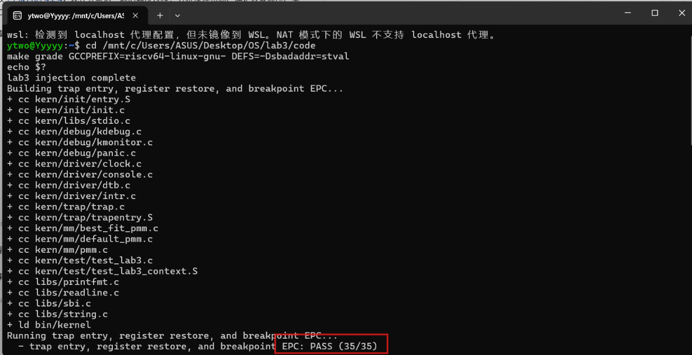
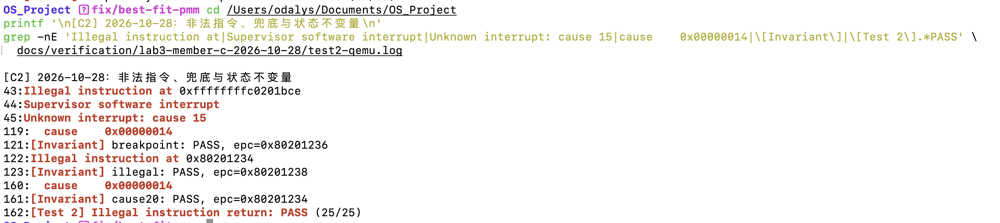
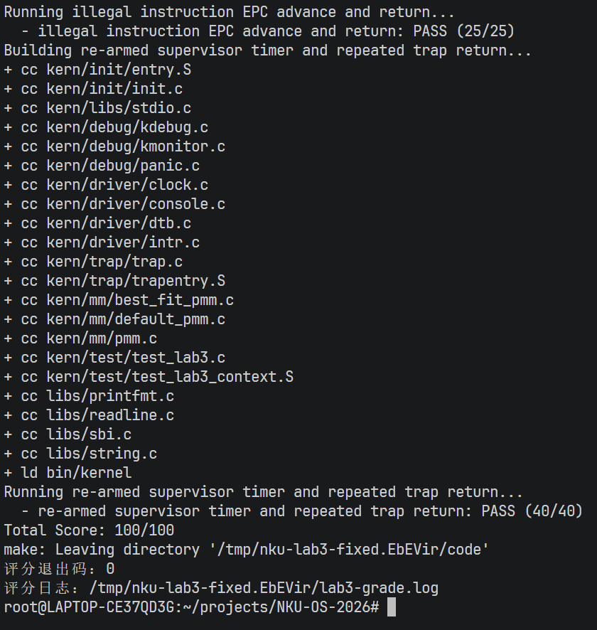
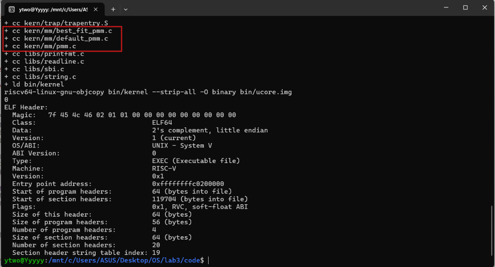
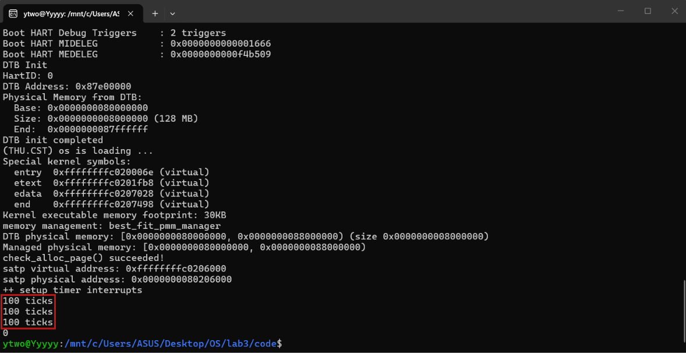
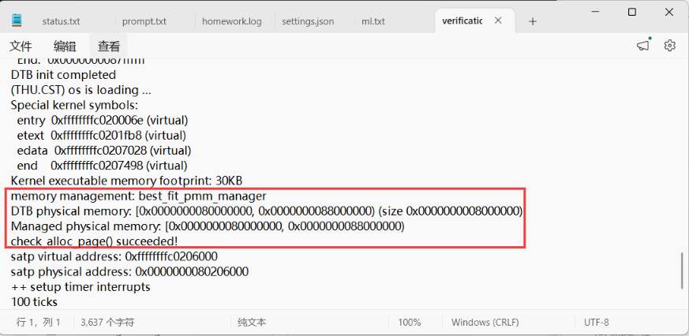

# OS\-lab3

# **实验基本信息**

|项目|内容|
|---|---|
|**实验名称** |Lab 3: 中断处理|
|**小组成员**|2412266\-杨滢、2412103\-唐健、2412566\-曹子衿|
|**完成日期** |2026\-11\-06|

## **小组分工**

### （1）练习分工

|成员|负责的练习/模块|
|---|---|
|2412266\-杨滢|功能模块一：Trap 上下文恢复与 Trap 入口功能|
|2412103\-唐健|`interrupt_handler()`；中断分类、时钟中断处理与未知中断兜底。|
|2412566\-曹子衿|`exception_handler()`、异常 EPC 更新、`do { ... } while (0)`|

### （2）实验报告撰写分工

|成员|负责的练习/模块|
|---|---|
|2412266\-杨滢|第4\.1、4\.2、5\.1\.1、5\.4节；第二、三、六章|
|2412103\-唐健|第 4\.3\.1、5\.2\.2、5\.3 节|
|2412566\-曹子衿|第 4\.3\.2、5\.1\.2、5\.2\.1、5\.5 节|

---


# **一、实验目的**

1. 理解 RISC\-V 中断与异常的分类，以及 `stvec`、`scause`、`sepc`、`sstatus` 在 Trap 处理中的作用。

2. 掌握 Trap 上下文保存、C 语言分发、处理及恢复的完整流程，通过断点、非法指令和持续时钟中断验证返回行为。

3. 学习用明确的功能规格和实际测试约束 AI 辅助开发，并根据机器码、控制台日志和状态不变量判断实现是否符合要求。

---

# **二、实验环境**

## 2\.1 你们使用的 AI 工具

|成员|AI 编程工具|底层模型|备注|
|---|---|---|---|
|2412266\-杨滢|OpenAI Codex|GPT\-6 Astra|无|
|2412103\-唐健|OpenAI Codex|GPT\-6 Astra|无|
|2412566\-曹子衿|OpenAI Codex|GPT\-6\.1 Sol|无|

**说明：**

- **AI 编程工具**：指具体使用的终端工具、编辑器插件、桌面应用或浏览器界面

- **底层模型**：指该工具使用的大语言模型及版本

## 2\.2 实验环境

本实验成员1、成员2主要在 Windows 主机的 WSL2 环境中完成，使用 RISC\-V 交叉工具链编译内核，通过 QEMU 模拟 RISC\-V 64 位计算机，并由 OpenSBI 完成固件初始化与内核启动。成员3在macOS环境完成。

为使实验框架适配当前工具环境，本次构建通过 `DEFS=-Dsbadaddr=stval` 兼容模板中的旧 CSR 名称，并明确指定目标指令集、ABI 和 `-fno-pie` 编译选项。QEMU 使用 `-kernel` 加载内核镜像，同时修正启动阶段的分页切换流程，使内核能够正常进入初始化代码。

本次评分使用的命令为：

```Plain Text
make grade GCCPREFIX=riscv64-linux-gnu- DEFS=-Dsbadaddr=stval
```

---

# 三、实验整体逻辑分析

### 3\.1 本章节的逻辑主线

本实验围绕 **发生 Trap 后，内核如何保存现场、完成处理并恢复执行”**展开。Trap 包括中断和异常：中断由时钟等外部事件异步触发，异常则与当前执行的指令有关，例如断点和非法指令。二者产生原因不同，但都需要通过统一入口进入内核处理。

发生 Trap 时，处理器会记录返回地址、原因及相关状态，并跳转到 `stvec` 指定的入口，但不会自动保存全部通用寄存器。因此，内核需要通过汇编建立 Trap frame，保存被打断程序的执行现场，再将其交给 C 语言处理函数。处理函数根据 Trap 类型执行相应操作，必要时更新返回地址，最后由汇编恢复上下文并执行 `sret` 返回。

本章的核心是保证各阶段之间的一致性：保存和恢复使用相同的栈帧布局，汇编入口正确传递参数，处理函数正确识别类型并调整状态，返回阶段使用处理后的现场继续执行。

### 3\.2 功能的逐步实现

**1\. 首先迁移 Lab 2 的内存管理代码，完成前置准备。**

将 `page_init()` 和 best fit 分配器迁入 Lab 3，根据当前头文件和内存布局调整相关宏，保留框架提供的检查函数以及内存分配、释放操作中的中断保护。

这一阶段保证内核能够建立物理页描述符、识别可用内存并完成基础分配检查。前置代码能够正常编译和初始化，后续测试才能进入 Trap 处理环节。

**2\. 接着分析 Trap frame 布局，实现上下文恢复与入口调用。**

以框架提供的 `SAVE_ALL` 为依据，明确通用寄存器和各个 CSR 的保存位置，再实现与之对应的 `RESTORE_ALL`。恢复过程中需要正确写回 `sstatus` 和 `sepc`，并将原始 `sp` 放在最后恢复，避免破坏栈帧寻址。

随后在 `__alltraps` 中将当前帧地址放入 `a0`，调用 `trap()`，使汇编保存的现场能够直接被 C 语言处理函数访问。这一步建立了统一的入口与返回基础，是中断、异常处理正常工作的前提。

**3\. 然后实现中断分类与持续时钟处理。**

`trap_dispatch()` 根据 `scause` 的最高位区分中断和异常，将中断交给 `interrupt_handler()`。处理函数提取中断编号，识别软件中断、时钟中断和外部中断等类型，并对未知中断输出诊断信息。

时钟中断处理需要依次设置下一次时钟事件、增加 `ticks`，并在达到统计周期时输出信息。当前实现每累计 100 次时钟中断输出一次 `100 ticks`，累计输出三次后关机。重新设置时钟事件保证了中断能够持续发生，也使内核反复经历上下文保存与恢复过程。

**4\. 随后实现异常分类与返回地址更新。**

异常交给 `exception_handler()` 处理。对于本实验要求的断点和非法指令，处理函数输出异常信息，并根据对应指令长度更新 `tf->epc`，使返回后能够继续执行下一条指令。其他异常通过 `print_trapframe()` 输出现场。

这一阶段需要区分中断与异常的返回行为：时钟中断通常继续被打断的执行流，无需推进 EPC；已处理的断点和非法指令则需要跳过触发异常的指令，否则返回后会再次触发同一异常。

**5\. 最后通过课程测试和普通启动验证完整处理链路。**

Test 1 检查 Trap 入口、寄存器恢复及断点返回；Test 2 检查非法指令返回和兜底处理；Test 3 检查时钟能否持续触发并完成重复 Trap 返回。

此外，通过普通启动观察物理内存初始化、分配器自检和时钟输出，确认各模块在正常内核流程中能够协同工作。测试不仅检查某个函数是否产生预期输出，还验证处理后能否正确返回并继续执行，从而形成完整的 Trap 处理闭环。

---


# 四、实验内容与实现

## 4\.1 Lab 2 前置代码迁移

**负责人：** 2412266\-杨滢

本实验依赖 Lab 2 的**物理页管理**。迁移范围为 ：

- `kern/mm/pmm.c` 的 `page_init()` 

- `kern/mm/best_fit_pmm.c` 的最佳适应分配器主体

`page_init()` 从 DTB 获取物理内存范围，检查范围溢出及内核布局，设置物理与虚拟地址偏移。在内核末尾按页对齐放置 `Page` 描述数组，初始化描述符并标记保留页；随后将描述数组之后的完整物理页交给分配器。描述数组及内核占用范围不能作为空闲页分配。

best fit 遍历按地址排列的空闲块，选择满足请求且长度最小的块；长度相同时保留先遇到的低地址块。分配时拆分剩余块，释放时按地址插入并合并相邻块，维护 `nr_free`。`init_pmm_manager()` 选择 `best_fit_pmm_manager`。

---

## 4\.2 功能模块一：Trap 上下文恢复与 Trap 入口功能

**负责人：** 2412266\-杨滢

### 4\.2\.1 模块功能描述

本模块连接汇编入口和 C 处理函数，完成“保存现场 → 传入 Trap frame → 处理 Trap → 恢复现场 → 返回”的闭环。`SAVE_ALL` 已由框架提供，成员 A 实现 `RESTORE_ALL` 与 `__alltraps` 的调用部分。不得修改保存布局、`struct trapframe` 或 `trap()` 接口。

RV64 下 `REGBYTES=8`，Trap frame 共 36 个槽，即 288 字节，仍满足 16 字节栈对齐要求。

|槽号|字节偏移|内容|
|---|---|---|
|0—31|0—248|x0—x31；槽2为 Trap 前的 sp|
|32|256|sstatus|
|33|264|sepc|
|34|272|stval，模板名称为 sbadaddr|
|35|280|scause|

`SAVE_ALL` 先将原 sp 写入 `sscratch`，再分配栈帧，最后把原 sp 写入槽2。因此恢复 sp 必须放在最后，否则后续加载就会以错误地址为基址。

### **4\.2\.2 需要实现/修改的函数：**

涉及两个需要实现的汇编功能以及用于衔接的既有 C 接口：

```Assembly language
.macro RESTORE_ALL
__alltraps:
```

```C
void trap(struct trapframe *tf);
```

**功能说明：**

- **系统作用：** 建立从汇编保存现场到 C 处理函数、再恢复执行状态的完整通路。

- **主要场景：** 同步异常和异步中断发生后，正确传递当前 Trap frame；返回时使用处理函数更新后的 EPC。

- **模块交互：** 依赖框架 SAVE\_ALL 和 trapframe 布局，调用 trap\(\)，与成员 B/C 的中断、异常处理衔接，经 \_\_trapret 返回。

### 4\.2\.3 关键代码分析

#### （1）Trap 入口：保存现场并传递参数

```Assembly language
__alltraps:
    SAVE_ALL
    #lab3 function1 2412266
    mv a0, sp
    jal trap
```

发生 Trap 后，处理器进入 `__alltraps`，首先执行 `SAVE_ALL`，将通用寄存器和相关控制状态保存到当前栈上的 Trap frame。保存完成后，\`sp\` 指向该结构的起始位置。

RISC\-V 调用约定使用 `a0` 传递第一个参数，因此 `mv a0, sp` 将 Trap frame 的地址传给以下 C 函数：

```Plain Text
void trap(struct trapframe *tf);
```

汇编保存的栈内存与 `struct trapframe` 的字段布局一致，所以 C 函数可以直接通过 `tf` 读取寄存器、异常原因和返回地址，无需额外复制现场。

这里必须先保存现场，再准备参数和调用函数。因为设置参数会覆盖原来的 `a0`，\`jal trap\` 会覆盖 `ra`，C 函数也可能使用其他寄存器。先执行 `SAVE_ALL`，才能保证这些寄存器的原值在返回时仍可恢复。

#### （2）恢复控制状态：确定返回状态与执行位置

```Plain Text
LOAD t0, 32*REGBYTES(sp)
csrw sstatus, t0
LOAD t0, 33*REGBYTES(sp)
csrw sepc, t0
```

`RESTORE_ALL` 首先恢复 `sstatus` 和 `sepc`。RV64 下 `REGBYTES` 为 8，因此第 32、33 槽分别位于帧起始地址之后的 256 和 264 字节处，与 `SAVE_ALL` 的保存位置对应。

`sstatus` 保存 Trap 返回所需的特权级和中断状态信息；`sepc`决定返回后继续执行的位置。代码使用 `t0` 作为临时寄存器，将内存中的保存值写回对应 CSR。

恢复 `sepc` 时，必须读取处理完成后的 `tf->epc`。异常处理函数可能已经更新该字段，使返回后跳过触发异常的指令；时钟中断通常保持该字段不变，使程序继续被打断的执行流。因此，恢复代码只负责写回帧中的最终值，不自行增加固定偏移。

#### （3）恢复通用寄存器：保持槽位对应

以下为通用寄存器恢复代码的节选：

```Plain Text
LOAD x1, 1*REGBYTES(sp)
LOAD x3, 3*REGBYTES(sp)
LOAD x4, 4*REGBYTES(sp)
LOAD x6, 6*REGBYTES(sp)
# ……此处省略 x7—x30 的恢复指令……
LOAD x31, 31*REGBYTES(sp)
LOAD x5, 5*REGBYTES(sp)
LOAD x2, 2*REGBYTES(sp)
```

每条加载指令都从对应槽位取回寄存器的保存值。Trap 可能发生在程序执行的任意位置，因此不仅需要恢复普通函数调用中要求保留的寄存器，还必须恢复参数寄存器和临时寄存器，避免破坏被打断程序仍在使用的数据。

本实现恢复 `x1` 至 `x31`。`x0` 的值恒为零，不需要恢复。保存的 `scause` 和 `stval` 用于提供 Trap 原因和附加信息，不参与本次返回地址与特权状态的恢复，因此不需要写回。

#### （4）恢复顺序：t0 完成临时用途，sp 最后恢复

```Plain Text
LOAD x5, 5*REGBYTES(sp)
LOAD x2, 2*REGBYTES(sp)
```

这两条指令放在通用寄存器恢复部分的末尾，分别处理 `t0` 和 `sp`。

`x5` 即 `t0`，前面恢复 CSR 时使用它中转数据，因此必须在这些操作完成后再恢复其原值，否则恢复后的值会被再次覆盖。

`x2` 即 `sp`，整个恢复过程都以它作为 Trap frame 的寻址基准。如果过早恢复 `sp`，后续加载指令就会从错误的地址读取数据。因此，只有其他寄存器都恢复完成后，才能取回原来的栈指针。

槽 2 保存的是进入 Trap 前的原始 `sp`，而不是分配 Trap frame 后的地址。执行最后一条加载后，栈指针已经回到原位置，无需再额外增加 Trap frame 的大小。

#### （5）统一返回：通过 sret 恢复执行流

```Plain Text
__trapret:
    RESTORE_ALL
    sret
```

`trap()` 返回后，执行流进入 `__trapret`。C 函数按照调用约定恢复栈位置，使 `sp` 重新指向当前 Trap frame，随后展开 `RESTORE_ALL` 完成现场恢复。

最后执行 `sret`，根据 `sepc` 返回到指定指令位置，并根据 `sstatus` 中的状态完成特权级和中断使能的恢复。普通的 `ret` 只依据 `ra` 完成函数返回，不能替代 Trap 返回指令。

### 4\.2\.4 最终提示词

以下是经过迭代优化后，最终成功实现该功能的提示词：

```Markdown
[PROMPT]
完成 Lab 3 成员 A：迁移 Lab 2 的 page_init 和 best fit 主体，实现
trapentry.S 中的 RESTORE_ALL 与 __alltraps。保留 lab2/lab3 注释，
将 A 负责的 YOUR CODE 替换为学号 2412266。
[RELY]
先阅读真实的 SAVE_ALL、trap.h、riscv.h、内存布局、Lab 2 成品及
Lab 3 评分源码。以已有接口为准，不编造宏或改变 trap() 签名。
[GUARANTEE]
恢复布局与 SAVE_ALL 一致；sp 最后恢复；正确恢复 sstatus、sepc；
以 a0 传递当前 Trap frame，处理返回后执行 RESTORE_ALL 和 sret。
保留其他成员的处理函数及框架检查函数，不修改评分断言。
[SPECIFICATION]
先列出36个槽的布局和状态变化，再实现。迁移宏缺失时核实等价关系。
运行教师评分测试，并用命令行检查编译、反汇编及普通启动。
区分编译失败、启动失败和功能失败，记录实际结果，不虚构通过
```


### 4\.2\.5 实现迭代过程

本模块的实现经历了 \[N\] 次迭代，过程如下：

#### \(1\)第一次迭代

**遇到的问题：**

实现中需要处理的关键约束是**寄存器恢复次序**：恢复 CSR 需要临时寄存器，但该寄存器原值也必须恢复；恢复 sp 后又不能继续依赖原帧基址进行加载。另外，调用 `trap()` 会覆盖 ra 和参数寄存器，需要确认这些原值已经由 `SAVE_ALL` 保存。

**问题解决策略：**

1\. **确定恢复顺序。** 使用 t0 从32、33槽读取并写回 sstatus、sepc。先完成 t0 的临时用途，再从槽5恢复 t0 原值，避免刚恢复的值被后续操作覆盖。

2\. **保持栈帧基址。** 在所有其他寄存器加载结束后，最后从槽2恢复 x2/sp；恢复值是 Trap 前的栈指针，因此不再额外增加288字节。

3\. **区分需恢复的状态。** x0恒为零，无需加载；stval、scause用于诊断，无需写回。sstatus从帧中恢复，保留原特权状态；sepc从帧中读取，使成员 C 对 EPC 的更新能够用于返回。

4\. **建立 C 调用。** 在`SAVE_ALL`之后执行 `mv a0, sp`和 `jal trap`，将当前帧地址作为第一个参数。ra与a0的原值已在帧中，调用后可恢复。`trap()`返回后顺序进入已有的 `__trapret`，执行恢复和 `sret`。

5\. **按规格核对。** 对照 `SAVE_ALL` 逐项核对寄存器槽位，确认31个可写通用寄存器均有恢复位置，CSR偏移正确，sp最后恢复

**最终结果：**

完成 `RESTORE_ALL` 与 `__alltraps` 后，静态检查确认保存与恢复布局对应、参数传递符合调用约定。

**关键改进点总结（如有）：**

1. 将恢复所有寄存器的笼统要求细化为具体槽位及顺序约束，突出原sp的特殊保存方式。

2. 明确临时寄存器t0的使用与恢复顺序，避免恢复操作本身破坏现场。

3. 将入口的a0传参与返回的sepc恢复作为接口规格，使汇编实现与C处理函数衔接。

### **4\.2\.6 stvec 向后兼容思考**

旧入口地址要求4字节对齐，最低两位为00；新格式将低两位解释为 MODE，00仍表示 Direct。旧的合法入口地址写入后仍按原来的直接入口工作，高位继续表示基址，因此利用对齐留下的编码空间实现了兼容。

---


## 4\.3 功能模块二：中断与异常处理功能

### 4\.3\.1 `interrupt_handler()`

**负责人：** 2412103\-唐健

#### \(1\) 函数功能描述

`interrupt_handler(struct trapframe *tf)` 负责处理 RISC\-V 内核接收到的各类中断。Trap 发生后，底层汇编代码将处理器状态保存至 Trap frame，再由 `trap_dispatch()` 根据 `scause` 最高位判断 Trap 类型，并将中断交由本函数处理。

本函数首先从 `tf->cause` 中提取中断原因编号，再依据实验框架提供的 `IRQ_*` 宏进行分类。对于软件中断、外部中断及其他已知中断，输出相应的中断类型信息；对于无法识别的中断，调用 `print_trapframe(tf)` 输出完整上下文，便于分析中断原因。

时钟中断是本模块的核心。由于实验使用 SBI 提供的一次性定时事件，每次收到 Supervisor Timer Interrupt 后，均需调用 `clock_set_next_event()` 设置下一次时钟事件，同时更新全局计数器 `ticks`，并在计数达到 `TICK_NUM` 的整数倍时输出统计信息。通过这一机制，内核能够持续响应时钟中断，而不会在第一次中断后停止计时。

本函数仅负责中断识别与处理，不修改 `tf->epc`，也不承担寄存器恢复工作。处理完成后，控制流返回统一的 Trap 返回路径，由底层汇编恢复处理器状态并通过 `sret` 返回原执行流。

#### \(2\) 最终提示词

本模块采用 AI 辅助编程方式完成。提示词通过 `[PROMPT]`、`[RELY]`、`[GUARANTEE]` 和 `[SPECIFICATION]` 四个部分，明确实现目标、工程依赖、功能约束和验收标准。

```Assembly language
**[PROMPT]**
请在当前 NKU-OS-2026 操作系统实验仓库中完成 Lab 3 中断处理功能的代码实现。
本实验依赖 Lab 2。请先阅读当前分支的真实代码、实验框架及已有注释，重点检查 code/kern/trap/trap.c、相关头文件、时钟初始化代码和 SBI 接口，然后仅在规定的实验代码补全区域实现 interrupt_handler(struct trapframe *tf)。
要求直接修改项目中的真实源文件，不要只给出示例代码或修改建议。保留已有实现、函数签名和代码结构，不得擅自重写整个文件。不要修改 SAVE_ALL、RESTORE_ALL、__alltraps、__trapret、struct trapframe、trap()、trap_dispatch() 或 exception_handler()。
**[RELY]**
以当前仓库中的实际代码为唯一实现依据，核实 struct trapframe、tf->cause、中断原因宏、ticks、TICK_NUM、SHUTDOWN_AFTER、clock_set_next_event()、print_trapframe(tf) 以及 libs/sbi.h 中关机接口的真实定义，不得自行编造接口。
结合现有 trap_dispatch() 的分发逻辑，确认 interrupt_handler() 接收到的 tf->cause 是否保留最高位中断标志，并据此正确识别中断编号。
参考项目已有的 Makefile、QEMU 启动方式和测试脚本，不修改实验环境或依赖配置来规避代码问题。
遵循 RISC-V 特权架构与现有内核的中断处理约定，不修改与本模块无关的代码。
**[GUARANTEE]**
正确识别 IRQ_S_TIMER。每次时钟中断均调用 clock_set_next_event() 设置下一次时钟事件，并且只将 ticks 增加一次。
当 ticks 达到 TICK_NUM 的整数倍时，按照实验框架要求输出时钟统计信息，使用框架已有定义，不硬编码重复定义统计周期。
根据仓库中实际存在的关机阈值和关机接口实现规定的关机逻辑。
对框架中已定义且实验要求识别的其他中断进行分类并输出对应提示；对于未知中断，调用 print_trapframe(tf) 输出完整上下文。
保持 interrupt_handler(struct trapframe *tf) 的函数签名不变，与现有 Trap 分发和返回流程兼容。
不修改 exception_handler()、Trap 汇编、Trap frame 结构及其他无关函数，不通过修改评分脚本或屏蔽错误使测试通过。
**[SPECIFICATION]**
先阅读真实源代码及头文件，核对宏、变量、函数和输出格式，再编写实现。对 tf->cause 的处理必须符合当前 RISC-V 架构的中断原因编码。
时钟中断必须完成事件重装、正确计数与周期输出，避免漏设下一次时钟事件、重复计数或提前关机。
其他中断只实现实验要求的类型区分和提示输出，未知中断通过 print_trapframe(tf) 进行兜底，不增加无关的复杂中断处理机制。
修改后检查代码差异，确保仅修改指定区域，并使用项目已有的构建及测试流程进行编译验证。
若编译或测试失败，应根据实际错误定位原因，只修复本模块内的问题，不擅自修改其他成员负责的代码。
完成后汇报修改文件、实现逻辑、实际执行的测试命令、测试结果及尚未验证的问题，不得将未运行的测试描述为通过。
```


#### \(3\) 具体实现与关键设计

**1\. 中断原因提取与分类**

RISC\-V 的 `scause` 寄存器使用最高位区分中断与异常，其余位表示具体原因。在 RV64 环境下，第 63 位为中断标志。如果直接使用完整的 `tf->cause` 与 `IRQ_*` 宏比较，可能无法匹配对应的中断编号。

因此，程序首先屏蔽最高位，提取实际中断编号：

```Plain Text
uintptr_t cause = tf->cause &
    ~((uintptr_t)1 << (__riscv_xlen - 1));
```

这里使用 `__riscv_xlen` 获取架构寄存器宽度，而非固定写入 63，使表达式与当前编译目标保持一致。

随后使用 `switch (cause)` 对中断类型进行分类。程序采用框架提供的 `IRQ_S_SOFT`、`IRQ_S_TIMER`、`IRQ_S_EXT` 等宏，避免直接使用数字作为中断编号，提高了代码的可读性，也保证了与已有定义的一致性。

**2\. 软件中断与其他中断处理**

对于软件中断和其他已定义中断，本实验只要求识别其类型并输出提示信息，不涉及复杂的设备确认、调度或嵌套中断处理。

例如，Supervisor Software Interrupt 的处理为：

```Plain Text
case IRQ_S_SOFT:
    cprintf("Supervisor software interrupt\n");
    break;
```

当接收到监管态软件中断时，程序能够进入对应分支并输出中断类型。其他已知中断采用相同的分类方式，保持各分支的处理逻辑清晰、独立。

**3\. 时钟中断重装与周期计数**

时钟中断是本函数的核心处理流程。当前内核使用 SBI 一次性定时事件，时钟中断触发后不会自动安排下一次事件，因此需要在中断处理函数中显式重装定时器。

关键实现如下：

```Plain Text
case IRQ_S_TIMER:
    clock_set_next_event();
    ticks++;
    if (ticks % TICK_NUM == 0) {
        print_ticks();
    }
    break;
```

处理过程分为三个步骤。

首先，调用 `clock_set_next_event()` 设置下一次时钟事件，使内核能够持续收到时钟中断。

其次，执行 `ticks++`，记录一次时钟中断。本实验中 `ticks` 是全局时钟计数变量，每次时钟中断仅递增一次，避免计数失真。

最后，通过 `ticks % TICK_NUM == 0` 判断是否达到统计周期。当前框架定义 `TICK_NUM = 100`，因此每累计 100 次时钟中断，调用 `print_ticks()` 输出一次 `100 ticks`。

上述顺序保证了定时事件的连续性，同时将事件重装、次数统计和周期输出组织为一个完整的处理流程。

**4\. 未知中断的兜底处理**

对于未匹配任何已知中断类型的情况，程序使用 `default` 分支输出中断编号及完整 Trap frame：

```Plain Text
default:
    cprintf("Unknown interrupt: cause %d\n", (int)cause);
    print_trapframe(tf);
    break;
```

其中，`print_trapframe(tf)` 能够输出保存的通用寄存器、`status`、`epc`、`badvaddr` 和 `cause` 等信息，为分析未知中断提供现场状态。


**5\. Trap 返回与接口一致性**

`interrupt_handler()` 通过已有的 `trap_dispatch()` 调用，处理完成后正常返回。由于中断属于异步事件，不需要跳过某条触发异常的指令，本函数不修改 `tf->epc`。

Trap 上下文恢复由 `trapentry.S` 中的 `RESTORE_ALL` 和 `sret` 完成。本模块只负责中断分类与处理，保持了 C 语言中断处理逻辑与底层汇编恢复过程之间的职责划分。


---

### **4\.3\.2 exception\_handler\(\)**

**负责人：** 2412566\-曹子衿

#### **\(1\)函数功能描述**

我负责的 `exception_handler(struct trapframe *tf)` 接收 `trap_dispatch()` 分流后的同步异常，根据 `tf->cause` 区分断点、非法指令和其他异常。中断标志位的判断由公共分发逻辑完成。

断点和非法指令异常由当前指令触发，Trap frame 中的 EPC 保存该指令的位置。处理时先输出这一地址，再将 `tf->epc` 推进到下一条指令；其他异常通过 `print_trapframe(tf)` 输出现场，EPC 保持原值。

状态更新集中在已处理分支的 `tf->epc`，通用寄存器、`status`、`cause` 和 `badvaddr` 均保持原值。统一返回路径将更新后的 EPC 写回 `sepc`，与成员 A 的汇编恢复逻辑衔接。


#### **\(2\) 最终提示词**


我根据将提示词分为规格准备（P0）与异常实现（P1）。下面完整引用 Prompt 文档中的两条四段式原文。


##### **① P0：接手基线与异常接口梳理**

这条提示词用于梳理前置交付、接口约束和异常返回路径，并取得断点长度的构建证据。


```Plain Text
[PROMPT]
为成员 C 接手 Lab3 异常处理准备实现规格。核对 A/B 已交付的功能、当前 trap.c 基线以及异常返回路径，输出简明的接口说明、行为表和验收清单。

[RELY]
docs/lab3/member_C.md；
lab3.md 的功能模块二；
workspace/NKU-OS-2026-lab3/code/kern/trap/trap.c、trap.h、trapentry.S；
workspace/NKU-OS-2026-lab3/code/libs/riscv.h；
workspace/NKU-OS-2026-lab3/code/tools/test_lab3.c、test_lab3_context.S、grade.sh；
workspace/NKU-OS-2026-lab3/code/Makefile。

[GUARANTEE]
交付：
1. exception_handler 的输入、输出和状态修改范围。
2. 断点、非法指令、其他异常三类行为表。
3. 断点指令长度的构建证据。
4. A/B 前置交付情况及成员 C 的验证入口。

[SPECIFICATION]
沿 trap_dispatch → exception_handler → __trapret → sret 解释控制流，说明 tf->epc 的修改如何作用于最终返回地址。

核对 A 已提交的内存初始化、Trap 入口和恢复逻辑，以及 B 已提交的 interrupt_handler；以当前文件和真实交接记录为依据，区分已存在与已验证。

使用项目工具链和当前构建参数，在独立构建目录汇编测试源，或检查已有对应构建产物。通过反汇编确认测试断点实际占用 2 字节还是 4 字节，记录命令和相关指令。无法取得构建证据时，将这一项列为待验证。

确认非法指令测试使用 .word 0x0000007b，占用 4 字节；其他异常以 cause 20 的直接调用作为已有测试场景。

列出 Test 1、Test 2 对异常处理的要求，以及 Test 3 对集成回归的要求。区分课程要求、框架事实和项目选择。
```


##### **② P1：实现异常分类与精确返回**


这条提示词以 P0 确认的断点长度为依赖，规定 `exception_handler()` 的接口、三类处理行为和状态不变量。以下保留其编排时的基线说明。


```Plain Text
[PROMPT]
在 workspace/NKU-OS-2026-lab3/code/kern/trap/trap.c 中完成成员 C 的异常处理组件，支持断点异常、非法指令异常和其他异常的规定输出，使已处理异常能够返回后续执行流。

基于 B 最新交付的 trap.c，在现有 interrupt_handler 之后、trap_dispatch 之前添加 exception_handler。当前版本没有功能二占位注释，在新函数处补充 lab3 功能标记并填写我提供的真实学号；保留已有 interrupt_handler 和公共分发逻辑。交付实现、关键设计说明和实际验证结果。

[RELY]
lab3.md 的功能模块二；
docs/lab3/member_C.md；
P0 确认的断点指令长度及构建证据；
struct trapframe、CAUSE_BREAKPOINT、CAUSE_ILLEGAL_INSTRUCTION；
现有 cprintf、print_trapframe、trap_dispatch 和 Trap 返回路径；
workspace/NKU-OS-2026-lab3/code/tools/test_lab3.c、test_lab3_context.S、grade.sh。

[GUARANTEE]
实现接口：
void exception_handler(struct trapframe *tf);

正常返回时，已处理异常的 tf->epc 指向其后续指令；其他异常保留原 EPC。函数签名与 struct trapframe 布局保持一致。

[SPECIFICATION]
Pre-Condition：
tf 是框架提供的有效异常上下文，trap_dispatch 已完成中断与异常分流；断点长度已经由当前构建产物确认。

Case 1：tf->cause == CAUSE_BREAKPOINT
输出包含“Breakpoint at”和异常发生时 EPC 的信息。
将 tf->epc 推进实际断点指令的长度，使 Test 1 可以继续执行寄存器检查。

Case 2：tf->cause == CAUSE_ILLEGAL_INSTRUCTION
输出包含“Illegal instruction at”和异常发生时 EPC 的信息。
按本实验已知非法测试指令的 4 字节长度推进 tf->epc，使 Test 2 继续执行。

Case 3：其他异常
调用现有 print_trapframe(tf)，保持 tf->epc 不变。cause 20 的测试应通过现有打印函数产生评分所需的 cause 输出。

Requirements：
状态修改限于已处理分支中的 tf->epc，其余 Trap frame 字段保持原值。
使用现有 CAUSE_* 宏分类，输出地址采用框架支持的指针宽度格式。
实现以已确认的实验输入契约为基础，保持简洁。
完成后编译，并运行能够验证异常返回的真实 QEMU 测试；记录前置依赖造成的验证缺口。
```


##### **③ 行为规格汇总**

结合上述提示词与实际构建证据，我将当前实现的输入条件和后置条件整理如下。


|规格项|输入条件|输出与状态约束|
|---|---|---|
|前置条件|框架传入有效 Trap frame，公共分发已确认其为异常|沿用现有结构与接口|
|断点异常|`tf->cause == CAUSE_BREAKPOINT`|输出 `Breakpoint at` 及原 EPC；当前测试编码为 2 字节，EPC 加 2|
|非法指令异常|`tf->cause == CAUSE_ILLEGAL_INSTRUCTION`|输出 `Illegal instruction at` 及原 EPC；已知测试指令长 4 字节，EPC 加 4|
|其他异常|不属于上述两类，包括测试构造的 cause 20|调用 `print_trapframe(tf)`，EPC 保持不变|
|状态不变量|所有分支|除上述 EPC 更新外，Trap frame 的其余字段保持原值|


异常分类、规定输出和 EPC 更新参照实验指导书。我在当前测试输入下采用已确认的指令长度，并通过补充不变量检查核对状态更新。


#### **\(3\) 具体实现与关键设计**

##### **① 根据异常原因分类，先打印原始 EPC**

当前实现如下，保留了 `lab3` 标记和本人学号：

```C
/* lab3 function2 2412566 */
void exception_handler(struct trapframe *tf) {
    switch (tf->cause) {
    case CAUSE_BREAKPOINT:
        cprintf("Breakpoint at %p\n", (void *)tf->epc);
        tf->epc += 2;
        break;
    case CAUSE_ILLEGAL_INSTRUCTION:
        cprintf("Illegal instruction at %p\n", (void *)tf->epc);
        tf->epc += 4;
        break;
    default:
        print_trapframe(tf);
        break;
    }
}
```

两个分支均先打印原 EPC，再更新返回位置。地址使用与指针宽度匹配的 `%p` 输出，保留 RV64 地址的完整信息。

##### **② 根据实际编码确定断点长度**

`tools/test_lab3_context.S` 使用 `ebreak` 触发断点。我根据构建产物确定其编码长度，2026\-10\-28 保存的反汇编结果如下：


```Plain Text
ffffffffc0201aa4:  9002      ebreak
ffffffffc0201aa6:  10500513  li a0,261
```

机器码 `9002` 为 16 位压缩断点编码，下一条指令位于原地址后 2 字节处，因此当前断点分支采用 `tf->epc += 2`。推进 4 字节会越过下一条指令的起始位置，保持原 EPC 则会再次执行断点。当前实现直接采用已确认的长度；工具链或汇编选项变化时，我会重新反汇编核对。

##### **③ 非法指令按已知的 4 字节推进**

`tools/test_lab3.c` 通过以下内联汇编触发非法指令异常：

```C
asm volatile(".word 0x0000007b");
```

测试源注明该指令在目标 RV64 平台上无效，占用 4 字节。我据此在输出原 EPC 后将其加 4，使执行流越过该测试指令，继续后续兜底检查。

##### **④ 其他异常保留现场**

默认分支调用 `print_trapframe(tf)` 并保留原 EPC 和其余字段。Test 2 构造 cause 20，通过普通 C 调用进入该分支，对应输出为 `cause    0x00000014`。这一场景检验现场打印与状态保持，真实异常返回由断点和非法指令测试检验。

##### **⑤ 通过统一返回路径使 EPC 更新生效**

`exception_handler()` 返回后，控制流经过 `trap_dispatch()`、`trap()` 回到 `__trapret`。`RESTORE_ALL` 从 Trap frame 的第 33 个槽位取出更新后的 EPC，写回 `sepc`；其余通用寄存器恢复后，`sret` 使用该地址继续执行。我负责的 handler 通过更新 Trap frame 与这条返回路径衔接。

普通硬件中断发生在指令执行边界，返回时沿用被打断位置的 EPC；本实验的断点和非法指令处理则将 EPC 推进到下一条指令。两类处理均经由统一路径恢复上下文并返回。

#### **\(4\) 实现核对与问题记录**

我接手时工作树中已有符合规格的未提交函数。我的此次工作以核对和验证为主：我确认断点机器码长度为 2 字节，保留了对应的 EPC 增量，确认了分类、输出和状态更新符合规格。


针对原评分侧重输出检查的特点，我结合独立副本中的快照比较，核对断点加 2、非法指令加 4、cause 20 保持原值及其余字段不变等后置条件。Test 1、Test 2 则用于检验真实 Trap 入口与返回。


#### **\(5\) 思考题：do \{ \.\.\. \} while \(0\) 的作用**

`kern/sync/sync.h` 中的宏为：

```C
#define local_intr_save(x) \
    do {                   \
        x = __intr_save(); \
    } while (0)
```


这一写法将宏体包装成一条语句，调用时可像函数调用一样在末尾添加分号，并放入不带大括号的 `if/else` 中。循环体执行一次后检查恒为假的条件，随后退出；宏体还提供可容纳局部变量的独立作用域。


如果宏直接展开为多条语句，例如：


```C
#define SAVE_BAD(x) x = __intr_save(); record_state(x)

if (need_protect)
    SAVE_BAD(flag);
else
    other_work();
```


展开后，第一条语句属于 `if`，第二条语句位于其后，使 `else` 失去匹配。改用大括号包装时，调用处的分号又会引入额外的空语句：


```C
#define SAVE_BLOCK(x) { x = __intr_save(); }

if (need_protect)
    SAVE_BLOCK(flag);  /* 展开后的 }; 在 if 与 else 之间多出空语句。 */
else
    other_work();
```


以上两个示例用于说明宏展开后的语法。使用 `do { ... } while (0)` 时，调用处的分号恰好结束整条语句，`if/else` 得以正常匹配。当前 `local_intr_save` 的宏体是一条赋值语句，采用相同写法便于后续扩展。


中断状态由 `__intr_save()` 保存：它读取 `sstatus.SIE`，原来允许中断时调用 `intr_disable()` 并返回 1，原来已关闭时返回 0。`__intr_restore(flag)` 根据保存值恢复中断使能状态。


`alloc_pages()`、`free_pages()` 在调用页分配器前保存并关闭本 hart 的中断，完成操作后按保存值恢复，从而保护同一 hart 上修改分配器数据结构的临界区。`do/while` 负责宏的语法组织，中断开关由内部函数执行；多核共享数据的互斥还需要锁等同步机制。

---


# 五、测试与验证

本章按测试目标组织结果。各成员在各自环境中运行测试，下文注明所用工具链和日志日期；同一测试的不同检查点分别分析，公共日志集中展示。

成员 B 的集成测试曾遇到 QEMU 启动问题：原评分脚本使用 `-device loader` 时，OpenSBI 显示 `Next Address: 0`，未进入内核。该次测试在独立副本中将加载参数改为 `-kernel bin/ucore.img`，保留测试代码、输出判定标准和超时设置，正式评分脚本未改动。下文 Test 2、Test 3 中成员 B 的评分截图来自这一环境；成员 C 的容器回归环境见第 5\.5 节。

## 5\.1 测试一：Trap 入口、寄存器恢复与断点返回

### 5\.1\.1 Trap 入口与寄存器上下文恢复

**负责人：** 2412266\-杨滢

#### \(1\) 测试目的

采用课程提供的 `tools/test_lab3_context.S` 与 Test 1。测试给 t0—t6、s0—s11、a1—a7 写入不同标记，执行 ebreak，返回后逐一比较，失败返回1，成功返回0，由 C 测试输出 PASS。gp、tp 被保留；该测试不是对所有寄存器、所有特权级和嵌套 Trap 的穷尽验证。断点 EPC 更新的具体实现由成员 C 在5\.1\.2说明。

#### \(2\) 测试过程

首先**运行教师评分测试**

```Bash
cd /mnt/c/Users/ASUS/Desktop/OS/lab3/code
make grade GCCPREFIX=riscv64-linux-gnu- DEFS=-Dsbadaddr=stval
echo $?
```

|命令或参数|含义与作用|
|---|---|
|`make`|读取当前目录的 Makefile，执行指定构建目标。|
|`grade`<br>|运行教师评分流程，依次编译、运行三项测试并检查输出。|
|`GCCPREFIX=riscv64-linux-gnu-`|选择本次使用的交叉工具链前缀，例如编译器为 `riscv64-linux-gnu-gcc`。|
|`DEFS=-Dsbadaddr=stval`|向预处理器传入宏定义，将模板旧 CSR 名称 sbadaddr 替换为 stval，使当前汇编器能够识别；不修改源文件中的保存代码。|

`make grade` 会先清理构建产物，将代码复制到 `/tmp/lab3_grade`，调用教师提供的 `tools/inject.py` 注入测试，再执行 `tools/grade.sh`。注入发生在临时副本中。运行过程中等待全部测试结束，不同时启动另一个评分任务。评分全部结束后，`$?` 保存上一条命令的退出状态，`echo` 将其打印到终端。

#### \(3\) 测试结果及分析



已保存日志显示 Test 1 为 `PASS (35/35)`。

该结果支持本次测试覆盖的寄存器在断点返回后得到正确恢复。35 分对应汇编入口、上下文恢复与断点处理共同构成的返回链路，不能拆成两个独立得分。

---

### 5\.1\.2 断点异常处理与 EPC 更新

**负责人：**2412566\-曹子衿

#### **\(1\) 测试目的与方法**

在第 5\.1\.1 节的返回测试基础上，本节核对断点的机器码、相邻指令地址及实际异常地址，检查 `tf->epc += 2` 的依据。

#### **\(2\) 检查命令及含义**

以下命令用于读取 2026\-10\-28 保存的构建与运行证据：

```Bash
cat docs/verification/lab3-member-c-2026-10-28/breakpoint-disasm.log
grep -nE 'Breakpoint at|\[Test 1\]' \
  docs/verification/lab3-member-c-2026-10-28/test1-qemu.log
```

`cat` 展示断点附近的反汇编；`grep -nE` 保留行号，并从 QEMU 日志提取异常地址与测试结果，用于核对反汇编位置和实际陷入位置是否一致。

2026\-11\-06 在成员 C 的容器环境中又编译同一测试汇编进行复核，命令如下。其中 `run_dir` 表示该次已创建的临时构建目录。

```Bash
riscv64-unknown-elf-gcc -mcmodel=medany -g -c \
    tools/test_lab3_context.S -o "$run_dir/test_lab3_context.o"
riscv64-unknown-elf-objdump -d "$run_dir/test_lab3_context.o" \
    > "$run_dir/breakpoint-disasm.log"
grep -B 2 -A 2 'ebreak' "$run_dir/breakpoint-disasm.log"
```

第一条命令生成目标文件，第二条反汇编代码段，第三条保留断点前后各两行以比较指令地址。

#### **\(3\) 结果与分析**

2026\-10\-28 的反汇编结果与Test 1 控制台对应如下：

```Plain Text
ffffffffc0201aa4:  9002      ebreak
ffffffffc0201aa6:  10500513  li a0,261

Breakpoint at 0xffffffffc0201aa4
[Test 1] Trap entry and breakpoint return: PASS (35/35)
```

异常地址与反汇编中的断点位置一致，下一条指令位于原 EPC 加 2 处，支持当前断点分支的返回地址更新。11 月 6 日的目标文件复核中，断点偏移为 `0x6a`，机器码仍为 `9002`，下一条指令位于 `0x6c`，结论一致，见[复核截图](images/image%205.png)。


---

## 5\.2 测试二：非法指令返回与兜底处理

### 5\.2\.1 非法指令异常与未知异常

**负责人：**2412566\-曹子衿

#### **\(1\) 测试目的与方法**

断点返回通过后，我继续检查非法指令的返回位置和其他异常的状态保持行为。Test 2 执行 `.word 0x0000007b` 触发非法指令异常，处理函数输出原 EPC 并将其推进 4 字节，程序随后进入兜底检查并输出 PASS。

兜底测试使用构造的 Trap frame，直接调用软件中断、未知中断和 cause 20 的处理函数。本节集中展示 Test 2 的公共日志，分析非法指令返回与 cause 20 异常兜底；软件中断和未知中断的输入构造及分析见第 5\.2\.2 节。

#### **\(2\) 检查命令及含义**

我从同一次运行日志中提取异常输出、兜底输出和快照比较结果：

```Bash
grep -nE 'Illegal instruction at|Supervisor software interrupt|Unknown interrupt: cause 15|cause    0x00000014|\[Invariant\]|\[Test 2\].*PASS' \
  docs/verification/lab3-member-c-2026-10-28/test2-qemu.log
```

`grep -nE` 的行号和扩展正则选项与前一测试相同。表达式按 `|` 分为六类匹配：非法指令地址、软件中断、未知中断、cause 20、状态不变量及 Test 2 PASS。`.*` 匹配 Test 2 标记与 PASS 之间的内容。这样可以沿日志顺序核对“非法指令返回 → 中断与异常兜底 → 状态比较 → 测试结束”的执行过程。

其中，`[Invariant]` 来自补充的C 语言不变量测试：调用前保存整个 Trap frame 的预期快照，按分支调整预期 EPC，再用 `memcmp` 比较所有字段。我据此检查 EPC 增量和其余现场的保持情况。

#### **\(3\) 结果与分析**

2026\-10\-28 保存的Test 2 控制台log包含如下字段：

```Plain Text
Illegal instruction at 0xffffffffc0201bce
Supervisor software interrupt
Unknown interrupt: cause 15
  cause    0x00000014
[Test 2] Illegal instruction return: PASS (25/25)
```

非法指令处理后能够继续执行兜底检查并到达 PASS，支持该测试指令的 EPC 推进和真实 Trap 返回正常。cause 20 输出 `cause    0x00000014`，说明进入了异常默认分支。

快照比较结果如下：

|分支|调用前 EPC|预期及实际调用后 EPC|整个 Trap frame 比较|
|---|---|---|---|
|断点|`0x80201234`|`0x80201236`|PASS，仅 EPC 加 2|
|非法指令|`0x80201234`|`0x80201238`|PASS，仅 EPC 加 4|
|cause 20|`0x80201234`|`0x80201234`|PASS，所有字段不变|

快照测试使用构造的 EPC `0x80201234` 检查函数后置条件，前面的非法指令测试则记录真实异常地址并检验完整返回流程。



### 5\.2\.2 软件中断与未知中断

**负责人：** 2412103\-唐健

#### （1）测试目的

检查 `interrupt_handler()` 能否正确去除中断标志位、识别监管态软件中断，并对未知中断原因打印诊断信息。

#### （2）测试方法

框架的 `test_lab3_handler_fallbacks()` 构造 Trap frame 并直接调用处理函数，关键输入如下：

```C
memset(&tf, 0, sizeof(tf));
tf.cause = IRQ_S_SOFT | ((uintptr_t)1 << 63);
interrupt_handler(&tf);

tf.cause = 15;
interrupt_handler(&tf);
```

第一组输入保留 RV64 的最高位中断标志，检查屏蔽该位后能否匹配 `IRQ_S_SOFT`；第二组直接传入未知原因 15，检查默认分支。这里绕过了公共 Trap 入口与分发，验证范围是 handler 的分类和输出行为。

#### （3）结果与分析

第 5\.2\.1 节公共日志中的两条中断提示分别对应上述输入，支持软件中断识别及未知中断兜底符合预期。成员 B 在本章开头说明的隔离环境中复测，Test 2 同样通过，见[评分截图](images/lab32.png)。该项得分属于整个 Test 2，包含异常处理和中断兜底的共同检查。

---

## 5\.3 测试三：持续时钟中断

**负责人：** 2412103\-唐健

### （1）测试目的

验证开启中断前 `ticks` 为 0，开启后能够持续计数至 200，并产生周期输出。时钟重装、计数与输出的实现见第 4\.3\.1 节，本节重点检查多次中断后的执行结果。

### （2）测试方法

框架通过 `test_lab3_timer_is_armed()` 和 `test_lab3_wait_for_timer()` 检查初始状态及持续计数。开启中断前的检查为：

```C
if (ticks != 0) {
    cprintf("[Test 3] Sustained supervisor timer: "
            "FAIL (ticks before enable=%d)\n",
            (int)ticks);
}
```

开启中断后，测试等待计数达到 200：

```C
while (ticks < 200) {
    asm volatile("" ::: "memory");
}
```

空内联汇编中的 `"memory"` clobber 约束编译器优化，使循环持续观察 `ticks` 的变化。计数过程中预期每累计 100 次中断输出一次 `100 ticks`，达到 200 后输出：

```Plain Text
[Test 3] Sustained supervisor timer: PASS (40/40, ticks=200)
```

### （3）测试结果及分析

成员 B 在本章开头说明的集成环境中得到以下评分结果：

```Plain Text
Running re-armed supervisor timer and repeated trap return...
  - re-armed supervisor timer and repeated trap return: PASS (40/40)
```



持续计数需要反复完成 Trap 进入、处理和返回，因此该结果支持定时事件重装与上下文恢复能够在此场景下协同工作。它没有逐项比较每一次时钟中断前后的全部寄存器，也不替代独立的关机验证；三次输出后正常退出的检查见第 5\.5 节。

## 5\.4 编译与内存管理基础验证

**负责人：** 2412266\-杨滢

### \(1\) 测试目的

本节验证4\.1迁移的 `page_init()` 和 best fit 分配器能够在 Lab 3 框架中完成构建，并通过普通内核启动时已有的内存检查。

本节重点观察物理内存初始化、实际选用的分配器以及 `check_alloc_page()` 结果。普通启动同时会出现时钟输出。

### \(2\) 测试过程

首先确认工具，干净构建。

```Bash
cd /mnt/c/Users/ASUS/Desktop/OS/lab3/code
make clean
make GCCPREFIX=riscv64-linux-gnu- DEFS=-Dsbadaddr=stval
echo $?
riscv64-linux-gnu-readelf -h bin/kernel
```

这组命令先清理旧构建产物，再根据当前源码重新生成内核和镜像。这里保留一次 `make clean` 是为了确认当前代码能够从头完成构建，避免复用旧目标文件；它不会删除实验源码。后面的 `make` 执行默认构建目标，使用指定的 RISC\-V 工具链和 CSR 名称兼容参数，不运行评分测试。最后紧接着查看退出状态，预期为0。



之后普通启动检查前置内存管理。

```Bash
make qemu GCCPREFIX=riscv64-linux-gnu- DEFS=-Dsbadaddr=stval
echo $?
```

这组命令使用普通内核镜像启动 QEMU。由于上一段已经完成构建，源码和构建条件没有变化时，`make qemu` 会直接使用生成的镜像，不需要再次清理。等待内核执行到自动关机，再查看退出状态。



内核初始化时先从 DTB 获取内存信息，随后 `pmm_init()` 选择 best fit 管理器，调用 `page_init()` 建立页描述符和空闲页范围，再通过 `check_alloc_page()` 调用管理器的检查函数。终端中的以下输出分别对应这些步骤：

|关键输出|说明|
|---|---|
|`memory management: best_fit_pmm_manager`|当前实际启用了迁入的最佳适应分配器。|
|`DTB physical memory: ...`|已取得设备树报告的物理内存范围。|
|`Managed physical memory: ...`|已确定内核管理的物理地址范围。|
|`check_alloc_page() succeeded!`|本次运行通过了框架已有的内存分配检查。|

其中 `check_alloc_page()` 会调用 best fit 管理器中的检查逻辑，检查基本分配与释放、最佳适应选择及空闲页计数等条件。只有检查函数正常返回，才会输出成功信息；因此该输出比单纯观察到内核启动信息更能支持迁移结果有效。

### \(3\) 测试结果及分析

本次已保存的 `verification-normal.log` 中包含：

```Plain Text
memory management: best_fit_pmm_manager
DTB physical memory: [0x0000000080000000, 0x0000000088000000) (size 0x0000000008000000)
Managed physical memory: [0x0000000080000000, 0x0000000088000000)
check_alloc_page() succeeded!
```



日志显示，内核成功读取物理内存信息、启用 best fit 管理器，并完成已有的分配器检查，支持 Lab 2 前置代码已与 Lab 3 集成。普通启动中的关机次数与退出状态检查见第 5\.5 节。

## 5\.5 集成回归与自动关机补充验证

**负责人：** 2412566\-曹子衿

### （1）集成回归总结

成员 C 在 macOS 宿主上的项目容器中完成复测，容器架构为 `x86_64`，工具链为 SiFive GCC 10\.2\.0，模拟器为 QEMU 4\.1\.1（`os-project-signalfd4-1`）。测试使用排除旧 `bin/obj` 的独立源码副本，并通过 `GRADE_TMP` 指定单独的评分目录。

2026\-11\-03 与 11 月 6 日的回归结果一致：三项测试分别为 35/35、25/25、40/40，总分 100/100；11 月 6 日记录的 `make grade` 退出码为 0。测试目标及分项分析见第 5\.1—5\.3 节，评分证据见[11 月 3 日汇总](images/image%203.png)及[11 月 6 日回归截图](images/image%205.png)。断点编码的复核命令与结论已集中放在第 5\.1\.2 节。

### （2）普通启动与退出状态检查

第 5\.4 节已展示普通构建和内存自检，本节补充对关机条件的自动检查：既要恰好输出三次 `100 ticks`，也要在观察上限内正常退出，避免把外部超时终止误判为关机成功。

以下命令在该次已完成普通构建的独立 `code` 副本目录中执行；`run_dir` 表示本次临时目录，用于保存日志。此处保留该容器实际使用的 `-device loader` 加载方式，与本章开头成员 B 的环境区分。

```Bash
set +e
timeout 35s qemu-system-riscv64 \
    -machine virt -nographic -bios default \
    -device loader,file=bin/ucore.img,addr=0x80200000 \
    </dev/null > "$run_dir/normal-qemu.log" 2>&1
qemu_rc=$?
set -e
cat "$run_dir/normal-qemu.log"
```

`timeout 35s` 限定观察时间，超时会返回 124；`qemu_rc=$?` 紧接调用保存退出码。`set +e` 允许先取得非零退出状态，随后恢复脚本的错误处理。输出与错误均保存到 `normal-qemu.log`，便于同时核查启动过程和退出结果。

其中 `</dev/null` 用于给 QEMU 单独设置标准输入。此前通过 `docker exec -i ... bash -s` 执行脚本时，QEMU 与 Bash 共用输入流，出现 EOF 报错；改用独立输入后，Bash 能继续读取并执行后续检查命令。

QEMU 返回后执行：

```Bash
printf 'normal QEMU exit code: %s\n' "$qemu_rc"
tick_count=$(grep -c '^100 ticks' "$run_dir/normal-qemu.log" || true)
printf '100 ticks output count: %s\n' "$tick_count"
test "$qemu_rc" -eq 0
test "$tick_count" -eq 3
```

`grep -c` 统计周期输出行数；两条 `test` 分别检查退出码为 0、输出次数为 3。脚本在两项检查均通过后输出 PASS。

### （3）结果与分析

2026\-11\-06 的实际结果为：

```Plain Text
normal QEMU exit code: 0
100 ticks output count: 3
普通 QEMU 自行退出且恰好三次周期输出：PASS
```


报告所记录的最终实现中，`SHUTDOWN_AFTER = 3` 的单位是“100 ticks 输出次数”，对应第三次周期输出后的关机条件。上述结果同时满足次数和退出状态检查，支持普通内核按该条件关机；Test 3 则已在 `ticks=200` 完成持续中断检查。11 月 3 日保存的普通启动记录得到相同结果，见[早期复核记录](images/image%201.png)。

---

# 六、实验总结与收获

## 6\.1 对操作系统的理解

本次实验使我们进一步理解了中断与异常处理的完整过程。处理器进入 Trap 只是处理流程的起点，操作系统还需要保存执行现场、识别事件类型、完成相应处理，并恢复寄存器和控制状态，才能让程序继续运行。任何一个环节出现错误，都可能表现为重复异常、寄存器值损坏或无法返回。

### （1）实验知识点与操作系统原理的联系

本实验把操作系统原理中的中断、上下文保存、特权控制和临界区保护落实为具体的寄存器操作与处理函数。各知识点与原理的对应关系如下。

|实验知识点|对应的 OS 原理及含义|本实验中的联系与差异|
|---|---|---|
|中断与异常分类|中断是与当前指令执行异步发生的事件，异常则由当前指令同步触发；操作系统根据事件原因选择处理方式。|`trap_dispatch()` 根据 `scause` 最高位区分中断与异常，再交给两个 handler 分类处理。本实验的时钟中断、断点和非法指令分别体现了这两类事件；软件中断与未知中断的兜底测试使用构造的 Trap frame 直接调用 handler，只验证分支行为，不等同于真实硬件中断的完整处理流程。|
|Trap frame 与上下文保存、恢复|上下文是程序继续执行所需的处理器状态。保存现场使处理程序能够使用寄存器，恢复现场使被打断的执行流能够继续运行。|`SAVE_ALL` 将通用寄存器和相关 CSR 保存到 Trap frame，`RESTORE_ALL` 恢复返回所需状态，并由 `sret` 返回。保存布局与恢复偏移必须一致，`sp` 最后恢复。本实验返回同一执行流，尚未涉及从一个进程切换到另一个进程所需的调度、地址空间切换等操作。|
|异常返回地址与控制流恢复|异常处理既要识别原因，也要确定返回后从哪里继续执行；返回地址取决于异常是否需要重试、跳过或终止。|本实验根据已确认的测试指令长度，将断点 EPC 加 2、非法指令 EPC 加 4，再由汇编写回 `sepc`。时钟中断保持 EPC 不变。这种跳过指令的处理针对本实验输入，不能直接推广到所有异常；例如缺页异常在修复映射后通常需要重新执行原指令。|
|特权状态与 Trap 返回|特权级限制程序可执行的操作，Trap 入口与返回机制负责按体系结构规则保存和恢复权限及中断状态。|本实验通过 `stvec` 指定统一入口，从 Trap frame 恢复 `sstatus`、`sepc`，再执行 `sret`。`sret` 根据 `sstatus.SPP` 决定返回的特权级，并恢复相应中断使能状态；本实验主要验证内核 S 态发生 Trap 后返回 S 态，并不意味着每次 Trap 都发生用户态与内核态之间的切换。|
|时钟中断与抢占式调度|周期性时钟事件使操作系统能够计时，并为时间片耗尽检查和抢占式调度提供触发机会。|`clock_set_next_event()` 重装下一次事件，`ticks++` 记录中断次数，达到统计周期时输出信息，达到关机条件时结束运行。本实验验证了持续时钟事件及重复 Trap 返回，尚未实现就绪队列、时间片分配或选择下一个进程。|
|中断屏蔽与临界区保护|临界区是访问共享状态、需要避免不安全交错执行的代码区域。保护方式取决于并发来源。|页分配和释放前通过 `local_intr_save()` 保存并关闭本 hart 的中断，完成后恢复先前状态，避免本 hart 上的中断处理与分配器操作交错。关闭本地中断不能阻止其他 hart 同时访问共享数据，因此不能替代多核互斥锁；`do { ... } while (0)` 只保证宏的语法组织，不提供互斥。|

这些对应关系说明，Trap 处理既依赖硬件提供的原因记录和返回机制，也依赖软件维持现场布局、调用约定及状态更新的一致性。本实验建立了后续系统调用、进程调度和异常恢复所需的基础，但这些上层功能仍需各自的数据结构与处理策略。

### （2）操作系统原理中重要但本实验尚未涉及的知识点

1. **进程与线程管理。** 本实验没有建立进程控制块、独立进程上下文及进程生命周期管理，Trap 上下文恢复也不等同于进程切换。

2. **CPU 调度。** 虽然已经具备持续时钟中断，但尚未实现就绪队列、时间片轮转、优先级调度等机制。

3. **用户态与系统调用。** 本实验没有完整实现用户程序加载、用户栈与内核栈切换，以及用户态通过系统调用请求内核服务的流程。

4. **虚拟内存的动态管理。** 实验使用了启动页表，但没有实现完整的缺页处理、按需分配、页面置换和交换机制。

5. **多核同步。** 当前验证没有覆盖多个处理器同时修改共享数据的情况，还需要自旋锁、原子操作及内存顺序等机制提供支持。

6. **复杂设备与文件系统。** 本实验对部分中断进行识别和提示，但尚未实现完整设备驱动、设备请求处理和文件系统管理。

## 6\.2 AI 协作开发的经验

**首先，明确规格比直接要求“补全代码”更有效。** 在实现 Trap 恢复之前，需要先说明寄存器保存位置、栈帧大小、参数传递方式和返回路径。将这些约束写入提示词，能够使生成代码围绕现有框架展开，也便于后续逐项检查。

**其次，迁移代码需要核对目标框架。** Lab 3 依赖 Lab 2，但不同实验的头文件、宏定义和检查逻辑不一定完全相同。迁移时应明确需要保留的实现与接口，避免整份覆盖造成新框架中的中断保护或测试代码丢失。

**第三，必须区分构建成功、启动成功和功能测试通过。** 编译链接完成只能说明代码能够生成内核镜像；OpenSBI 输出正常也不能证明已经进入内核。只有观察到相应测试执行并满足通过条件，才能对功能作出判断。本次排查过程中，我们结合启动地址、异常记录和实际输出，逐步区分了工具兼容、启动流程与功能实现的问题。

**第四，AI 生成的解释和代码都需要证据支持。** 对于上下文恢复，可以通过保存布局与恢复指令核对实现，再用教师测试检查 Trap 返回后的寄存器值。报告中的结论也应对应真实日志和截图，不能将预期结果写成已经完成的验证。


---


